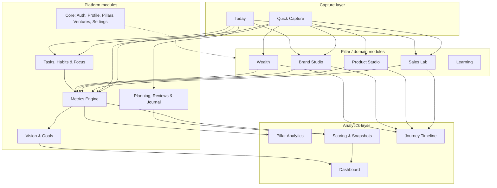

# 2. Application Modules

FiveYearOS is organised as **5 platform modules** that every pillar uses and **5 pillar/domain modules** that hold domain data. A **capture layer** and an **analytics layer** span all of them.

**Core rule:** domain modules never compute progress themselves. They write domain records (an interaction, a publication, a balance snapshot). The **Metrics Engine** turns those into numbers. **Goals** and **Scoring** read only from the Metrics Engine. That single seam keeps analytics consistent and lets new modules plug in later.

---

## 2.1 Core (Auth, Profile, Pillars, Ventures, Settings)

| | |
|---|---|
| **Purpose** | Identity, configuration and the lookup data everything else references |
| **Entities** | `profiles`, `journeys`, `pillars`, `ventures`, `tags`, `reminders`, `push_subscriptions`, `imports`, `attachments`. Identity lives separately in the `auth` schema: `auth.users`, `auth.sessions`, `auth.mfa_recovery_codes`, `auth.events`, `auth.rate_limits`. |
| **Screens** | Login, MFA challenge, MFA setup + recovery codes, Onboarding wizard, Settings (profile, pillars, ventures, metrics, templates, notifications, data, security) |
| **Key behaviour** | Journey = 5-year window (day 1…1,826). Pillar weights drive the overall score. Ventures separate employer selling from own-business selling and income. |

## 2.2 Vision & Goals

| | |
|---|---|
| **Purpose** | Turn the five-year vision into a cascade of time-boxed, measurable goals |
| **Entities** | `visions` (versioned), `goals` (self-referencing hierarchy), `goal_measurements`, `goal_dependencies`, `goal_links`, `journey_events`. **Implemented, see [08-goal-engine.md](08-goal-engine.md).** |
| **Screens** | Vision, Goal tree, Goal detail (KRs, milestones, linked tasks/projects, progress chart), Journey timeline |
| **Key behaviour** | Levels: `five_year → annual → quarterly → monthly → weekly → daily`. Each goal carries its own success metric, baseline and target. Progress = `(current − baseline) / (target − baseline)`, clamped to 0–100%, which also works for "down" goals such as debt. The current value comes only from logged outcome measurements, so tasks and sub-goals never complete a goal. *Expected progress* = elapsed share of the period. Health is suggested from the gap between the two. |

## 2.3 Metrics Engine

| | |
|---|---|
| **Purpose** | One source of numeric truth for every KPI, manual or derived |
| **Entities** | `metric_definitions`, `metric_entries`, `metric_targets`, view `metric_facts`, SQL function `metric_series` |
| **Screens** | Metrics settings (catalogue), Metric detail (series, targets, entries), counter widgets |
| **Key behaviour** | Flow vs stock semantics; optional scope (product/platform/account/venture); effective-dated targets; derived metrics declared once in SQL. Details in [04 §5](04-database-architecture.md#5-the-metrics-engine). |

## 2.4 Tasks, Habits & Focus

| | |
|---|---|
| **Purpose** | Daily execution |
| **Entities** | `projects`, `tasks`, `habits`, `habit_logs`, `focus_sessions` |
| **Screens** | Tasks (list / board / by goal), Inbox, Habits (check-in + heatmaps), Focus timer |
| **Key behaviour** | Top-3 flag per day; recurring tasks via RRULE; habit target snapshotted on each log; focus minutes become a derived metric per pillar. |

## 2.5 Planning, Reviews & Journal

| | |
|---|---|
| **Purpose** | The rituals that turn data into decisions |
| **Entities** | `period_plans`, `review_templates`, `reviews`, `journal_entries`, `score_snapshots` |
| **Screens** | Morning plan, Evening shutdown, Weekly plan, Review hub, Review wizard (per period type), Journal |
| **Key behaviour** | One review per `(period_type, period_start)`. The wizard opens with an auto-generated summary, then asks the template questions. Answers are stored as JSONB with the template version. Completing a weekly review writes the score snapshots for that week. |

## 2.6 Sales Lab

| | |
|---|---|
| **Purpose** | Build sales mastery through volume, measurement and deliberate practice |
| **Entities** | `organizations`, `contacts`, `interactions`, `interaction_playbook_items`, `pipeline_stages`, `deals`, `deal_stage_history`, `playbook_items`, `practice_sessions` |
| **Screens** | Sales overview, Call/interaction quick log, Prospects list, Contact detail (timeline), Follow-ups, Pipeline kanban, Deal detail, Playbook, Practice log, Funnel analytics |
| **Funnel** | dials → connects → conversations → meetings booked → proposals → won. Each step is a derived metric, so conversion rates come free. |
| **Learning loop** | Interactions record which script was used and which objections came up. The Playbook shows usage, meeting rate and win rate per item. |

## 2.7 Product Studio

| | |
|---|---|
| **Purpose** | Find real problems, build, launch and earn revenue |
| **Entities** | `ideas`, `experiments`, `products`, `releases`, `subscriptions` (customer revenue), plus shared `contacts` and `interactions` (purpose `discovery`) |
| **Screens** | Idea board (scored), Idea detail (evidence, interviews, experiments), Products, Product detail (status, releases, revenue, product metrics), Experiments, Launch log |
| **Key behaviour** | Products can be software or educational offerings (course, workshop, coaching), so the "communication educator" business is modelled too. MRR is a stock metric derived from active subscriptions. |

## 2.8 Brand Studio

| | |
|---|---|
| **Purpose** | Build an audience through consistent publishing about communication, sales psychology, human behaviour and entrepreneurship |
| **Entities** | `platforms`, `topics`, `content_items`, `content_publications`, `content_metric_snapshots` |
| **Screens** | Content board, Calendar, Content editor, Publication stats entry, Audience growth, Topic performance |
| **Key behaviour** | Ideas → published. One item, many publications (cross-posting). Performance is captured as dated snapshots because platform numbers keep growing. Followers per platform are platform-scoped stock metrics. Talks and workshops are content formats; paid workshops and courses are products. |

## 2.9 Wealth

| | |
|---|---|
| **Purpose** | Grow income, savings and assets; remove debt; reach financial independence |
| **Entities** | `accounts`, `account_snapshots`, `liability_terms`, `categories`, `transactions`, `budgets`, `income_streams`, `fi_plans`, `fx_rates` |
| **Screens** | Wealth overview (net worth, FI %), Accounts, Monthly balance update, Income, Transactions (import, categorise), Budgets, Debts (payoff plan), FI plan |
| **Key behaviour** | Net worth comes from monthly balance snapshots, which works even if transactions are never tracked. FI number = annual expenses ÷ safe withdrawal rate. Projections use real (inflation-adjusted) returns. Business assets are accounts of kind `business_equity` linked to a venture. |

## 2.10 Learning

| | |
|---|---|
| **Purpose** | Make skill growth visible |
| **Entities** | `skills`, `skill_assessments`, `resources`, `notes` |
| **Screens** | Skills matrix (radar per pillar), Resources library, Notes (search) |
| **Key behaviour** | Self-assessments are point-in-time rows, so the radar can be replayed for any date. Practice sessions (Sales Lab) and notes link to skills. |

## 2.11 Dashboard, Analytics, Scoring & Timeline

| | |
|---|---|
| **Purpose** | Answer "is it working?" at every time horizon |
| **Entities** | Reads `metric_facts`, `score_snapshots`, goals and KRs, `journey_events` |
| **Screens** | Dashboard, Analytics per pillar, Compare periods, Year in review, Journey timeline |

---

## 2.12 Seed metric catalogue

Seeded at onboarding. The owner picks which to activate and sets targets. **L** = leading indicator, **G** = lagging. **Derived** metrics are computed. **Manual** metrics are typed in or counted with +1.

| Pillar | Key | Name | Type | Agg | L/G | Source |
|---|---|---|---|---|---|---|
| Sales | `sales.dials` | Dials | flow | sum | L | derived: interactions channel=call, purpose ∈ prospecting/sales |
| Sales | `sales.connects` | Connects | flow | sum | L | derived: call outcome ∉ no_answer, voicemail, wrong_number |
| Sales | `sales.conversations` | Conversations | flow | sum | L | derived: outcome ∈ conversation, callback_requested, meeting_booked, not_interested, closed_won |
| Sales | `sales.meetings_booked` | Meetings booked | flow | sum | L | derived |
| Sales | `sales.proposals_sent` | Proposals sent | flow | sum | L | derived: deal entered stage flagged `is_proposal` |
| Sales | `sales.deals_won` | Deals won | flow | sum | G | derived |
| Sales | `sales.revenue_won` | Revenue closed | flow | sum | G | derived: deals.value on closed_on |
| Sales | `sales.practice_minutes` | Practice minutes | flow | sum | L | derived: practice_sessions |
| Product | `product.discovery_interviews` | Discovery interviews | flow | sum | L | derived |
| Product | `product.experiments_completed` | Experiments completed | flow | sum | L | derived |
| Product | `product.build_minutes` | Build time | flow | sum | L | derived: focus_sessions in pillar |
| Product | `product.releases` | Releases shipped | flow | sum | L | derived |
| Product | `product.signups` | Signups | flow | sum | G | manual, scoped by product |
| Product | `product.active_users` | Active users | stock | last | G | manual, scoped by product |
| Product | `product.paying_customers` | Paying customers | stock | last | G | derived: active subscriptions |
| Product | `product.mrr` | MRR | stock | last | G | derived: active subscriptions |
| Brand | `brand.pieces_published` | Pieces published | flow | sum | L | derived: content_publications |
| Brand | `brand.writing_minutes` | Creation time | flow | sum | L | derived: focus_sessions |
| Brand | `brand.followers` | Followers | stock | last | G | manual, scoped by platform |
| Brand | `brand.impressions` | Impressions | flow | sum | G | derived: snapshot deltas |
| Brand | `brand.newsletter_subscribers` | Newsletter subscribers | stock | last | G | manual |
| Brand | `brand.inbound_leads` | Inbound leads | flow | sum | G | derived: contacts with source=content |
| Brand | `brand.people_taught` | People taught | flow | sum | G | manual |
| Wealth | `wealth.income` | Income | flow | sum | G | derived: transactions (income) or manual |
| Wealth | `wealth.own_venture_income` | Income from own ventures | flow | sum | G | derived |
| Wealth | `wealth.expenses` | Expenses | flow | sum | G | derived: transactions |
| Wealth | `wealth.savings_rate` | Savings rate | flow | ratio | L | derived: (income − expenses) / income per month |
| Wealth | `wealth.net_worth` | Net worth | stock | last | G | derived: account_snapshots |
| Wealth | `wealth.total_debt` | Total debt | stock | last | G | derived: liability accounts (direction = down) |
| Wealth | `wealth.invested` | Invested assets | stock | last | G | derived |
| Wealth | `wealth.emergency_months` | Emergency fund (months) | stock | last | G | derived |
| Wealth | `wealth.fi_progress` | FI progress % | stock | last | G | derived: invested ÷ FI number |
| All | `life.focus_minutes` | Deep work | flow | sum | L | derived |
| All | `life.mood` / `life.energy` | Mood / Energy | flow | avg | — | derived: journal |

## 2.13 Scoring model

Scores give one honest number per pillar per week. They are computed on weekly review completion (with a Vercel Cron fallback each Monday for missed weeks) and **stored** in `score_snapshots` with a `formula_version`, so changing the formula later never rewrites history.

**Pillar score (0–100) for week *w*:**

| Component | Weight | Definition |
|---|---|---|
| Leading indicators | 50% | Mean of `min(actual / target, 1)` over the pillar's active leading metrics that have a weekly target (direction-aware) |
| Goal pace | 30% | Mean over active quarter KRs of `min(progress / expected_progress, 1)`, where expected = elapsed share of the quarter |
| Habit adherence | 20% | Completed ÷ scheduled (skips excluded) for the pillar's habits |

A component with no inputs is dropped and the remaining weights are renormalised. **Overall score** = pillar scores weighted by `pillars.weight`. Every snapshot stores its components as JSON so any number can be explained later ("why was Sales 62 that week?").

**Formula v1 is deliberately simple.** Improvements become `formula_version = 2` and only apply from their effective week forward.
