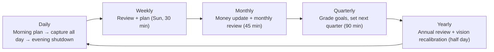

# 3. User Journeys and Navigation

## 3.1 User journeys

Each journey lists its trigger, the steps, the data it writes and its target duration. Together they form the **operating rhythm** of the five years:



### J1 — First-run onboarding (once, ~20 min)

| Step | Screen | Writes |
|---|---|---|
| 1 | Sign in with the owner account (created by CLI), enrol TOTP MFA, save 10 recovery codes | `auth.users` (MFA secret), `auth.mfa_recovery_codes`, `auth.sessions` |
| 2 | Journey basics: start date, timezone, base currency, week start | `profiles`, `journeys` |
| 3 | Confirm or edit the four pillars and their weights | `pillars` (seeded) |
| 4 | Add ventures: employer, own company, content brand | `ventures` |
| 5 | Write the five-year vision and one five-year outcome per pillar | `visions` v1, `goals` (level five_year) |
| 6 | Pick starter metrics and weekly targets per pillar | `metric_definitions`, `metric_targets` |
| 7 | Financial baseline: accounts and today's balances | `accounts`, `account_snapshots` |
| 8 | Pick 3–5 starter habits, choose reminder times, install the PWA | `habits`, `reminders`, `push_subscriptions` |
| → | Lands on **Today** with an empty-state checklist | |

### J2 — Morning plan (daily, ≤ 3 min)

Trigger: morning push notification, or opening the app before the day's plan exists.
1. Today shows yesterday's carry-over tasks and today's scheduled tasks.
2. Set an intention (one sentence).
3. Choose the **top 3** (each tagged to a pillar). The app warns if a pillar has had no top-3 item in 7 days.
4. Review today's counter targets (e.g. dials 0/50, posts 0/1).
→ Writes `period_plans` (day), `tasks.is_top_priority`.

### J3 — Log a cold call between dials (many times a day, ≤ 10 s)

1. Tap the **+** button, then **Call** (or use the *Log call* app shortcut).
2. Tap an outcome: *No answer · Voicemail · Gatekeeper · Conversation · Callback · Meeting booked · Not interested · Won*.
3. Optional: pick a contact, add a note, set next follow-up.
→ Writes `interactions`. The Dials, Connects and Meetings counters update instantly (optimistic) and work offline.

### J4 — Work a prospect to a closed deal (spans weeks)

1. Create contact and organisation (or create on the fly in J3).
2. Interaction outcome *Meeting booked* → app offers **Create deal** (venture, value, stage *Meeting*).
3. Drag the deal across the kanban; each move writes `deal_stage_history`.
4. Log interactions on the deal, choose the playbook script used, and tag objections heard.
5. Move to *Won* → closed date and value recorded → `sales.revenue_won` updates. If first-ever or above the record, a `journey_events` entry is suggested.
6. *Lost* requires a lost reason (feeds win/loss analysis).

### J5 — Evening shutdown (daily, ≤ 5 min)

1. Habit checklist (done / skip with reason).
2. Confirm manual metrics not yet logged today.
3. Journal: mood, energy, one win, one lesson, optional free text.
4. Unfinished top-3 tasks: roll to tomorrow, reschedule or drop.
→ Writes `habit_logs`, `metric_entries`, `journal_entries`, `tasks`.

### J6 — Weekly review and plan (Sunday, ~30 min)

1. **Auto summary:** pillar scores vs last week, metrics vs targets, habits adherence, tasks completed, deals moved/won, content published, money in/out, focus hours per pillar.
2. **Reflection (template v-current):** wins, what didn't go to plan, lessons, one thing to stop, start and continue.
3. **Pillar self-ratings** 1–10.
4. **Plan next week:** theme, 3–5 weekly outcomes linked to goals, adjust weekly targets if needed (creates new effective-dated target rows).
5. Complete → `score_snapshots` written for the week.
→ Writes `reviews` (week), `period_plans` (week), `score_snapshots`, maybe `metric_targets`.

### J7 — Monthly money update and review (first weekend, ~45 min)

1. **Balances:** a grid of all open accounts with last month's value pre-filled. Update each → `account_snapshots` (as_of = month end).
2. **Transactions:** import bank CSV → dedupe → categorise with rules → confirm.
3. **Auto summary:** net worth Δ, savings rate, income by stream (share from own ventures), FI %, debt payoff progress, MRR, followers Δ, revenue closed.
4. Monthly reflection, then review month-level goals and set next month's.

### J8 — Quarterly reset (~90 min)

1. Grade each quarter goal: achieved / partial / missed, with final KR values frozen into the review.
2. Health check against yearly goals: on pace?
3. Create next quarter's goals and KRs (wizard copies unfinished goals forward on request).
4. Skills self-assessment (radar), playbook pruning, pipeline stage review.

### J9 — Annual review and vision recalibration (half day)

1. Auto-generated **year in review**: every pillar's KPIs, best weeks, journey events, net worth curve, content and sales totals.
2. Grade the year's goals. Reflect on the template questions.
3. **Recalibrate the vision:** edit the five-year vision, which creates `visions` version n+1 (old versions stay viewable).
4. Set next year's goals. Optionally rebalance pillar weights (effective next year).

### J10 — Idea to revenue (Product Studio, spans months)

1. Capture idea (quick capture) → score pain, frequency, willingness to pay.
2. Status *Researching*: log discovery interviews as interactions with purpose `discovery` linked to the idea.
3. Status *Validating*: run experiments (landing page, pre-sale) with success criteria.
4. *Validated* → **Promote to product** (creates `products` row, links idea).
5. Log releases; launch → `journey_events` "Launched X".
6. Record customers as subscriptions or one-off sales → MRR and paying customers update.

### J11 — Content from idea to performance (Brand Studio)

1. Capture idea with a hook → board column *Idea*.
2. Move through outline → drafting → editing (markdown editor, focus timer counts creation time).
3. Schedule → appears on calendar and on Today on that date.
4. Publish → add one publication per platform with URL.
5. After 2 and 7 days (reminder), enter performance snapshot. Weekly: update followers per platform.

### J12 — Monthly data safety check (automated + 1 min)

The daily off-site backup job posts its status. Settings → Data shows the last backup, last export and row counts. A quarterly reminder prompts a restore drill into a scratch project.

---

## 3.2 Information architecture

```
FiveYearOS
├── Today                        ← default landing
├── Dashboard
├── Goals
│   ├── Vision (versions)
│   ├── Goal tree
│   └── Journey timeline
├── Plan & Review
│   ├── Week plan
│   ├── Reviews (hub → wizard per period)
│   ├── Journal
│   ├── Habits
│   └── Tasks (list · board · inbox)
├── Sales Lab
│   ├── Overview (funnel, targets)
│   ├── Pipeline
│   ├── Prospects & contacts
│   ├── Follow-ups
│   ├── Activity log
│   ├── Playbook
│   └── Practice
├── Product Studio
│   ├── Overview (MRR, customers)
│   ├── Ideas
│   ├── Products
│   └── Experiments
├── Brand Studio
│   ├── Overview (audience, output)
│   ├── Content board
│   ├── Calendar
│   └── Audience
├── Wealth
│   ├── Overview (net worth, FI %)
│   ├── Accounts & balances
│   ├── Income
│   ├── Transactions
│   ├── Budgets
│   ├── Debts
│   └── FI plan
├── Learning
│   ├── Skills
│   ├── Resources
│   └── Notes
├── Analytics (cross-pillar, compare, year in review)
└── Settings
    ├── Profile & journey
    ├── Pillars · Ventures
    ├── Metrics & targets
    ├── Review templates
    ├── Lists (stages, platforms, topics, categories)
    ├── Notifications
    ├── Data (export, import, backups)
    └── Security (MFA, sessions)
```

## 3.3 Navigation model

### Mobile (< 768 px): bottom tab bar + floating capture button

| Tab | Destination | Why it's top-level |
|---|---|---|
| **Today** | `/today` | Used many times daily |
| **Pillars** | `/pillars`, a 2×2 grid of pillar cards linking to each module overview | One tap to any domain |
| **＋** (centre, raised) | Quick capture sheet | The most frequent action |
| **Review** | `/plan`, with plan, reviews, journal and habits | The rituals |
| **More** | Goals, Dashboard, Analytics, Learning, Settings | Less frequent |

Inside a module, a horizontal segmented control switches sub-pages (e.g. Sales: Overview · Pipeline · Prospects · Follow-ups · Playbook).

### Desktop (≥ 1024 px): collapsible left sidebar

Sections in order: Today, Dashboard, Goals, Plan & Review, then a divider and **Pillars** (Sales Lab, Product Studio, Brand Studio, Wealth), then Learning, Analytics, then Settings at the bottom. Each pillar shows its colour dot and current weekly score.

### Global affordances

| Affordance | Behaviour |
|---|---|
| Command palette (`⌘K` / `Ctrl K`) | Jump to any page or entity; run actions ("log call", "new deal", "start focus") |
| Quick capture (`C` on desktop, **＋** on mobile) | Sheet with type picker: Task · Call/interaction · Metric · Content idea · Product idea · Money · Note · Win |
| Keyboard shortcuts | `G T` Today, `G D` Dashboard, `G S` Sales, `G P` Product, `G B` Brand, `G W` Wealth |
| Overdue banner | Shown on Today when a weekly/monthly review or monthly balance update is overdue |
| PWA shortcuts | Long-press app icon: *Log call*, *Quick capture*, *Today* (defined in the web manifest) |

## 3.4 Route map (Next.js App Router)

Route groups: `(auth)` is public and `(app)` is protected by the session guard. URLs use stable natural keys for periods (`/reviews/week/2027-03-01`) so they are bookmarkable and shareable from notifications.

| Route | Page |
|---|---|
| `/login`, `/login/mfa`, `/login/mfa/setup` | Sign-in, MFA challenge, first-time MFA enrolment |
| `/api/auth/login`, `/api/auth/mfa`, `/api/auth/refresh`, `/api/auth/logout` | Auth route handlers (JSON, `POST` only) |
| `/api/v1/sync` | Offline outbox replay (versioned, stable across deploys) |
| `/api/cron/[job]` | Scheduled jobs called by Vercel Cron (protected by `CRON_SECRET`) |
| `/onboarding/[step]` | Onboarding wizard |
| `/today` | Today |
| `/dashboard` | Dashboard |
| `/goals`, `/goals/[goalId]`, `/goals/vision`, `/goals/timeline` | Goal tree, detail, vision, timeline |
| `/plan`, `/plan/week/[weekStart]`, `/plan/day/[date]` | Plan hub, week plan, day plan |
| `/reviews`, `/reviews/[periodType]/[periodStart]` | Review hub, review wizard/read view |
| `/journal`, `/journal/[date]` | Journal list, entry |
| `/habits`, `/habits/[habitId]` | Habits, habit detail |
| `/tasks`, `/tasks/inbox` | Tasks, inbox |
| `/focus` | Focus timer |
| `/pillars` | Pillar grid (mobile hub) |
| `/sales`, `/sales/pipeline`, `/sales/deals/[dealId]` | Sales overview, pipeline, deal |
| `/sales/contacts`, `/sales/contacts/[contactId]`, `/sales/organizations/[orgId]` | Prospects, contact, organisation |
| `/sales/follow-ups`, `/sales/activity`, `/sales/playbook`, `/sales/practice` | Follow-ups, activity log, playbook, practice |
| `/product`, `/product/ideas`, `/product/ideas/[ideaId]` | Product overview, ideas, idea detail |
| `/product/products/[productId]`, `/product/experiments` | Product detail, experiments |
| `/brand`, `/brand/content`, `/brand/content/[contentId]`, `/brand/calendar`, `/brand/audience` | Brand Studio |
| `/wealth`, `/wealth/accounts`, `/wealth/balances/[month]`, `/wealth/income`, `/wealth/transactions`, `/wealth/budgets`, `/wealth/debts`, `/wealth/fi` | Wealth |
| `/learning/skills`, `/learning/resources`, `/learning/notes`, `/learning/notes/[noteId]` | Learning |
| `/analytics`, `/analytics/[pillarKey]`, `/analytics/compare`, `/analytics/year/[journeyYear]` | Analytics |
| `/metrics/[metricKey]` | Metric detail |
| `/settings/[section]` | Settings sections |
| `/manifest.webmanifest`, `/sw.js` | PWA manifest and service worker |
