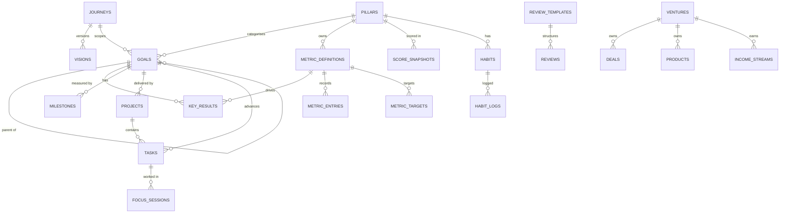
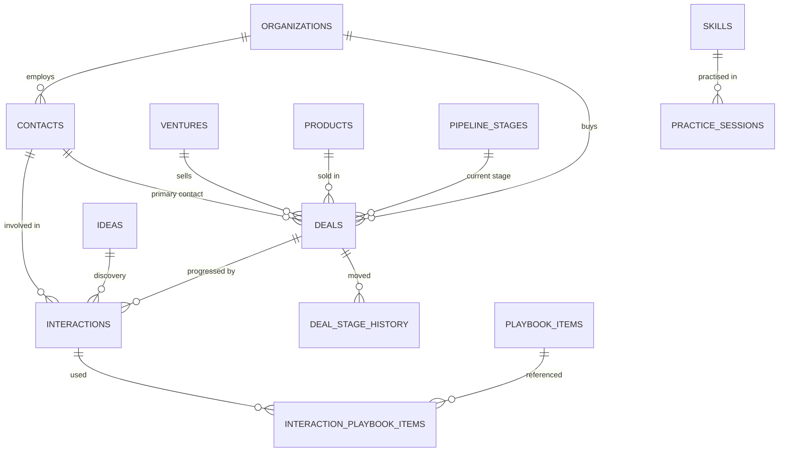
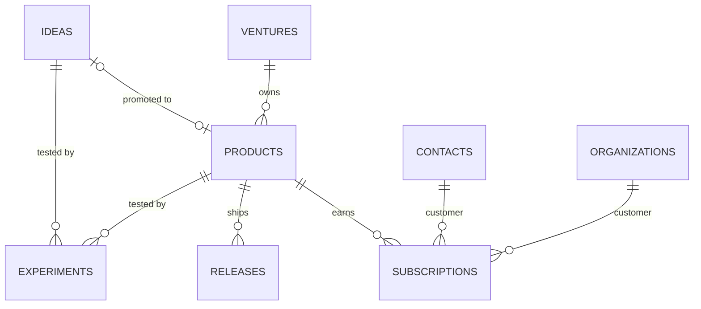
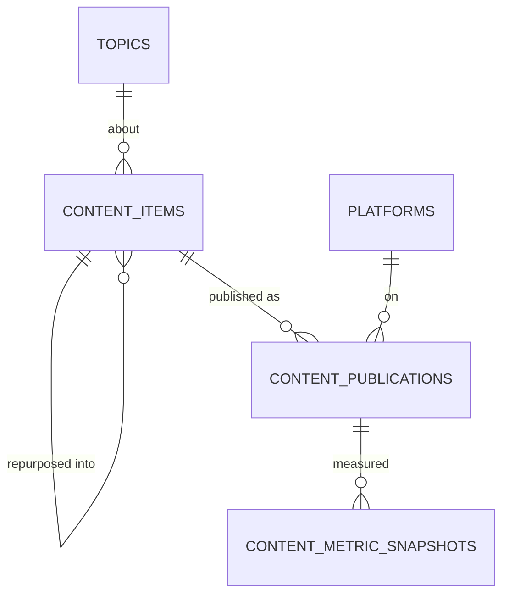
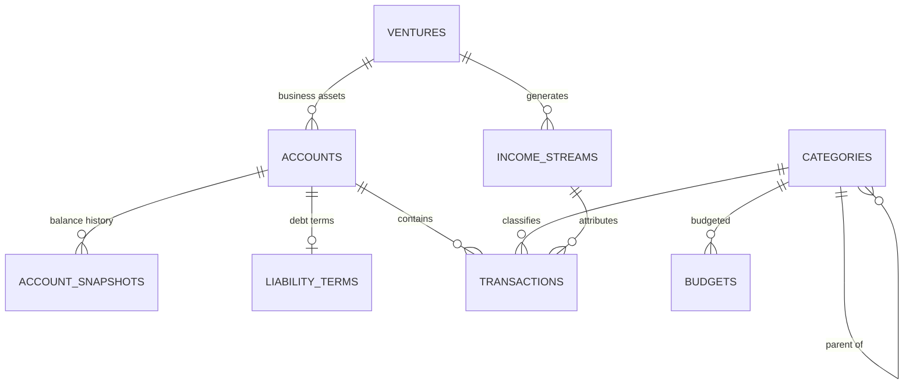

# 4. Database Architecture

PostgreSQL 17 on **Neon** (serverless Postgres). **Only the Next.js server connects to the database. There is no browser-facing database API.** TypeScript accesses it through **Drizzle ORM**.

| Schema | Contents | Reachable by |
|---|---|---|
| `public` | All application data, RLS-protected | `fyos_app` (runtime role) |
| `auth` | Users, sessions, recovery codes, auth audit, rate limits | `fyos_auth` (used only by `lib/auth`) |
| `app` | Helper functions such as `app.current_user_id()` | Both runtime roles (execute only) |

Roles, connection handling and policies are specified in [06 §4](06-security.md#4-authorisation-row-level-security).

## 1. Design principles

1. **Domain tables record what happened. The metrics engine says what it means.** Domain tables (interactions, publications, snapshots) are the source of truth. Numbers on dashboards come from `metric_facts`.
2. **Additive evolution.** New pillars, KPIs, stages, platforms and review questions are data, not schema.
3. **History is immutable where it matters.** Targets are effective-dated. Scores, balances and content stats are snapshots. Templates and visions are versioned.
4. **Single owner, multi-tenant safe.** Every row has `user_id`, and RLS guards every table.
5. **Plain Postgres.** No business logic in proprietary features. A `pg_dump` is a complete, portable backup.

## 2. Conventions applied to every table

| Convention | Rule |
|---|---|
| Primary key | `id uuid primary key default gen_random_uuid()`. Clients may supply the id, which makes offline inserts idempotent (retrying the same id is an upsert, not a duplicate). |
| Ownership | `user_id uuid not null default app.current_user_id() references auth.users(id) on delete cascade`. `app.current_user_id()` reads the transaction-local `app.user_id` setting, which the server sets from the verified JWT. |
| Audit columns | `created_at timestamptz not null default now()`, `updated_at timestamptz not null default now()`, maintained by a shared `set_updated_at()` trigger |
| Archive, not delete | `archived_at timestamptz` on user-managed entities. UI lists filter `archived_at is null`. Hard delete only via "empty trash" after 30 days. |
| Calendar date vs instant | Events store **both** `occurred_at timestamptz` (the instant) and `occurred_on date` (the local calendar date in the owner's timezone at capture time). All daily/weekly aggregation uses `occurred_on`, so streaks never drift across timezones or DST. |
| Money | `amount_minor bigint` (cents/paise) + `currency char(3)` (ISO 4217). Never float. Reporting converts via `fx_rates` to `profiles.base_currency`. |
| Small fixed value sets | `text` + `check (col in (...))`. Easier to evolve than Postgres enums (adding a value is a one-line migration; removing one never needs a type rewrite). |
| User-editable value sets | Lookup tables: `pillars`, `ventures`, `pipeline_stages`, `platforms`, `topics`, `categories`, `income_streams` |
| Same-owner integrity | Parent tables declare `unique (id, user_id)`. Children reference `(parent_id, user_id)` with a composite FK, so a row can never point at another user's data even if RLS were misconfigured. Optional references use `on delete set null (parent_id)` (PG15 column-list syntax). |
| Escape hatch | Major entities carry `custom_fields jsonb not null default '{}'` for experimental attributes. Promote a field to a real column once it is filtered, sorted or aggregated. |
| Naming | `snake_case`, plural table names, `*_on` for dates, `*_at` for timestamps, `*_minor` for money, `is_*`/`has_*` for booleans |
| Ratings | `smallint check (x between 1 and 5)` for mood/energy/quality; `1–10` for self-ratings/skills |

Standard column block (abbreviated as **std** in the tables below):

```sql
id          uuid primary key default gen_random_uuid(),
user_id     uuid not null default app.current_user_id() references auth.users(id) on delete cascade,
created_at  timestamptz not null default now(),
updated_at  timestamptz not null default now(),
unique (id, user_id)            -- enables same-owner composite FKs from children
```

## 3. Domain map



Domain-specific diagrams appear with each section below.

---

## 4. Table catalogue

### 4.1 Core & identity

| Table | Columns (beyond **std**) | Notes |
|---|---|---|
| `profiles` | `id uuid pk → auth.users`, `display_name`, `timezone text` (IANA), `base_currency char(3)`, `locale text`, `week_starts_on smallint` (0=Sun…6=Sat, default 1), `active_journey_id`, `settings jsonb` | One row per user, created at onboarding. No `std` block; `id` is the user id. |
| `journeys` | `name`, `start_date date`, `end_date date`, `status` (planned/active/completed), `notes` | A 5-year horizon. A second five-year plan is a new row, so history stays separate and queryable. |
| `pillars` | `key text` (unique per user: sales, product, brand, wealth), `name`, `description`, `color`, `icon`, `weight numeric(5,2)`, `sort_order`, `archived_at` | Seeded with 4. A fifth pillar (Health, Family) is an insert. |
| `ventures` | `name`, `kind` (employer/own_company/freelance/content_brand/investment/other), `status` (active/paused/exited/closed), `started_on`, `ended_on`, `ownership_pct numeric`, `notes`, `archived_at` | Where work and money happen. Lets analytics split employer sales from own-business sales and income. |

**Identity (`auth` schema).** These tables are not RLS-scoped, because login has to look a user up by email before anyone is authenticated. Isolation comes from privileges instead: only the `fyos_auth` role can touch them, and the application role cannot read them at all.

| Table | Columns | Notes |
|---|---|---|
| `auth.users` | `id uuid pk`, `email citext unique`, `password_hash text` (argon2id PHC string), `password_changed_at`, `mfa_totp_secret_enc bytea` (AES-256-GCM), `mfa_enabled_at`, `mfa_last_used_step bigint`, `failed_login_count int`, `locked_until timestamptz`, `last_login_at`, `token_version int default 1`, `created_at`, `updated_at` | Created only by the owner CLI. Bumping `token_version` invalidates every session and outstanding access token. `mfa_last_used_step` blocks TOTP code replay. |
| `auth.sessions` | `id uuid pk` (= JWT `sid`), `user_id`, `refresh_token_hash bytea` (SHA-256), `previous_refresh_token_hash bytea`, `rotated_at`, `aal smallint`, `user_agent`, `ip_prefix inet`, `created_at`, `last_used_at`, `expires_at` (sliding), `absolute_expires_at`, `revoked_at`, `revoke_reason` | One row per signed-in device. The refresh token rotates on every use. A previous token presented after the grace window counts as reuse and revokes the session. |
| `auth.mfa_recovery_codes` | `id`, `user_id`, `code_hash`, `used_at` | 10 single-use codes, generated at MFA enrolment |
| `auth.events` | `id`, `user_id`, `kind` (login_ok/login_fail/mfa_ok/mfa_fail/refresh/reuse_detected/logout/logout_all/password_change/lockout/recovery_code_used), `session_id`, `ip_prefix`, `user_agent`, `occurred_at` | Insert-only security audit, shown in Settings → Security |
| `auth.rate_limits` | `key text` (e.g. `login:ip:<prefix>`), `window_start timestamptz`, `count int` | PK `(key, window_start)`. Fixed-window limiter that works across serverless instances. Rows older than a day are purged nightly. |

### 4.2 Strategy: vision, goals, key results

| Table | Columns (beyond **std**) | Notes |
|---|---|---|
| `visions` | `journey_id`, `version int`, `title`, `statement text` (markdown), `pillar_statements jsonb` (`{pillar_key: text}`), `is_current bool`, `effective_from date` | Edit = insert new version and flip `is_current`. Partial unique index: one current per journey. |
| `goals` | `journey_id`, `pillar_id`, `parent_goal_id` (self-FK), `level` (five_year/year/quarter/month), `title`, `description`, `why text`, `period_start date`, `period_end date`, `progress_mode` (key_results/milestones/manual), `manual_progress numeric(5,4)`, `status` (not_started/active/achieved/partial/missed/dropped), `health_override` (on_track/at_risk/off_track or null), `final_grade numeric(5,4)`, `sort_order`, `custom_fields`, `archived_at` | Check: `period_end >= period_start`. A child's period must fall inside its parent's (validated in app + trigger). |
| `key_results` | `goal_id`, `metric_id` (nullable), `title`, `kr_type` (metric/milestone/boolean), `baseline_value numeric`, `target_value numeric`, `measure` (period_total/latest_value), `scope_type`, `scope_id`, `weight numeric default 1`, `final_value numeric`, `sort_order` | `period_total` sums a flow metric over the goal period. `latest_value` reads a stock metric at period end. `final_value` is frozen at quarterly/annual grading. |
| `milestones` | `goal_id`, `title`, `due_on`, `completed_on`, `sort_order` | Used when `progress_mode = milestones` |
| `journey_events` | `journey_id`, `pillar_id`, `occurred_on`, `kind` (win/first/launch/milestone/lesson/setback/decision), `title`, `description`, `significance smallint` (1–5), `source_type`, `source_id` | The five-year story. Auto-suggested from domain events (first deal won, product launched, debt cleared), confirmed by the owner. |

### 4.3 Execution: projects, tasks, habits, focus

| Table | Columns (beyond **std**) | Notes |
|---|---|---|
| `projects` | `pillar_id`, `goal_id`, `venture_id`, `name`, `description`, `status` (planned/active/on_hold/done/cancelled), `start_on`, `target_on`, `completed_on`, `archived_at` | Optional grouping between goals and tasks |
| `tasks` | `pillar_id`, `goal_id`, `project_id`, `title`, `notes`, `status` (inbox/todo/doing/done/cancelled), `priority smallint` (1–4), `due_on`, `scheduled_on`, `is_top_priority bool`, `estimate_minutes`, `completed_at`, `recurrence_rule text` (RRULE), `recurrence_parent_id`, `source_type`, `source_id`, `sort_order`, `archived_at` | Recurring: the template task holds the RRULE; instances are materialised a rolling 14 days ahead. Partial index `where status not in ('done','cancelled')`. |
| `habits` | `pillar_id`, `name`, `description`, `cue text`, `target_type` (boolean/count/duration), `target_value numeric`, `unit`, `schedule_days smallint[]` (0–6), `start_on`, `end_on`, `sort_order`, `archived_at` | |
| `habit_logs` | `habit_id`, `occurred_on date`, `status` (done/partial/skipped/missed), `value numeric`, `target_value_snapshot numeric`, `skip_reason`, `note` | `unique (habit_id, occurred_on)`. The target snapshot means changing a habit never rewrites past adherence. |
| `focus_sessions` | `pillar_id`, `task_id`, `product_id`, `content_item_id`, `started_at`, `ended_at`, `occurred_on`, `duration_minutes int` (generated from start/end, or manual), `quality smallint` (1–5), `note` | Feeds `*.build_minutes`, `brand.writing_minutes`, `life.focus_minutes` |

### 4.4 Rituals (planning, reviews, journal)

| Table | Columns (beyond **std**) | Notes |
|---|---|---|
| `period_plans` | `period_type` (day/week/month/quarter/year), `period_start date`, `period_end date`, `intention text`, `theme text`, `outcomes jsonb` (`[{title, goal_id, done}]`), `template_version int` | `unique (user_id, period_type, period_start)` |
| `review_templates` | `period_type`, `name`, `version int`, `questions jsonb` (`[{id, prompt, kind: text/rating/list/choice, required}]`), `is_active bool` | Editing creates a new version. Seeded with one template per period type. |
| `reviews` | `period_type`, `period_start`, `period_end`, `template_id`, `answers jsonb` (keyed by question id), `pillar_ratings jsonb` (`{pillar_id: 1–10}`), `summary_snapshot jsonb` (auto-summary frozen at completion), `status` (draft/completed), `completed_at` | `unique (user_id, period_type, period_start)`. `summary_snapshot` keeps the numbers as you saw them, even if data is corrected later. |
| `journal_entries` | `entry_date date`, `mood smallint`, `energy smallint`, `gratitude text`, `wins text`, `lessons text`, `body text` (markdown), `search tsvector` (generated) | `unique (user_id, entry_date)`. GIN index on `search`. |

### 4.5 Sales Lab



| Table | Columns (beyond **std**) | Notes |
|---|---|---|
| `organizations` | `name`, `industry`, `size_band`, `website`, `city`, `country`, `notes`, `custom_fields`, `archived_at` | Shared with Product (customers) and Brand (collaborators) |
| `contacts` | `organization_id`, `full_name`, `job_title`, `email`, `phone`, `linkedin_url`, `source` (cold_list/referral/inbound_content/event/network/other), `source_detail`, `relationship` (prospect/lead/customer/partner/mentor/network), `next_follow_up_on`, `last_interaction_at` (trigger-maintained), `notes`, `custom_fields`, `archived_at` | One contact can be a prospect, an interviewee and a customer over time. One timeline. |
| `interactions` | `venture_id`, `contact_id`, `organization_id`, `deal_id`, `idea_id`, `purpose` (prospecting/sales/discovery/customer_success/networking/brand), `channel` (call/email/linkedin/whatsapp/sms/meeting/video_call/event/dm), `direction` (outbound/inbound), `occurred_at`, `occurred_on`, `duration_seconds`, `outcome` (see below), `self_rating smallint`, `notes`, `next_step`, `next_step_on` | All are nullable except purpose, channel and dates, so an anonymous dial is one row with three fields. **Call outcomes:** no_answer, voicemail, gatekeeper, wrong_number, conversation, callback_requested, meeting_booked, not_interested, closed_won, closed_lost. |
| `interaction_playbook_items` | `interaction_id`, `playbook_item_id`, `role` (script_used/objection_heard/close_attempted/story_told), `worked bool` | PK `(interaction_id, playbook_item_id, role)` |
| `pipeline_stages` | `venture_id` (nullable = default pipeline), `name`, `sort_order`, `probability numeric(3,2)`, `is_proposal bool`, `is_won bool`, `is_lost bool`, `archived_at` | Seeded: Lead → Qualified → Meeting → Proposal → Negotiation → Won / Lost |
| `deals` | `venture_id`, `organization_id`, `primary_contact_id`, `product_id`, `stage_id`, `title`, `value_minor`, `currency`, `expected_close_on`, `status` (open/won/lost), `closed_on`, `lost_reason`, `source`, `notes`, `custom_fields`, `archived_at` | `status` is kept in sync with the stage's `is_won`/`is_lost` flags by trigger |
| `deal_stage_history` | `deal_id`, `from_stage_id`, `to_stage_id`, `changed_at`, `changed_on` | Insert-only, written by trigger on `deals.stage_id` change. Powers velocity and the proposal count. |
| `playbook_items` | `kind` (script/opener/discovery_question/objection/response/close/story/email_template), `title`, `body` (markdown), `parent_id` (response → objection), `skill_id`, `archived_at` | Stats (usage, meeting rate, win rate) come from a view, never stored |
| `practice_sessions` | `skill_id`, `kind` (roleplay/call_review/drill/presentation/course_exercise), `occurred_on`, `duration_minutes`, `partner`, `self_rating smallint`, `feedback text`, `recording_path` | |

### 4.6 Product Studio



| Table | Columns (beyond **std**) | Notes |
|---|---|---|
| `ideas` | `title`, `problem_statement`, `target_customer`, `current_alternatives`, `evidence text`, `pain_score`, `frequency_score`, `wtp_score`, `reach_score`, `confidence_score`, `effort_score` (all smallint 1–5), `priority_score numeric` (generated), `status` (captured/researching/validating/validated/building/rejected/parked), `rejected_reason`, `product_id`, `custom_fields`, `archived_at` | `priority_score = (pain × frequency × wtp × reach × confidence) / effort`. The formula can change by editing the generated column in a migration. |
| `products` | `venture_id`, `idea_id`, `name`, `tagline`, `kind` (software/course/workshop/coaching/template/service/community), `status` (concept/building/beta/launched/growing/maintenance/sunset), `pricing_model` (free/one_time/subscription/usage/hybrid), `launched_on`, `sunset_on`, `url`, `repo_url`, `custom_fields`, `archived_at` | Educational offerings are products too |
| `experiments` | `idea_id`, `product_id`, `hypothesis`, `method` (interviews/landing_page/presale/prototype/ads/concierge/other), `metric_description`, `success_criteria`, `started_on`, `ended_on`, `result_summary`, `outcome` (running/validated/invalidated/inconclusive) | Check: idea_id or product_id is not null |
| `releases` | `product_id`, `version`, `kind` (launch/major/minor/patch/content), `released_on`, `notes` | `kind = launch` suggests a journey event |
| `subscriptions` | `product_id`, `contact_id`, `organization_id`, `plan_name`, `billing` (monthly/yearly/one_time), `amount_minor`, `currency`, `started_on`, `cancelled_on`, `cancel_reason`, `external_ref` | MRR on date *d* = Σ monthly-normalised amount of rows active on *d*. One-time sales feed revenue but not MRR. |

### 4.7 Brand Studio



| Table | Columns (beyond **std**) | Notes |
|---|---|---|
| `platforms` | `name`, `kind` (social/video/newsletter/blog/podcast/community/offline), `handle`, `url`, `color`, `sort_order`, `archived_at` | Followers per platform are `brand.followers` entries with `scope_type = 'platform'` |
| `topics` | `name`, `description`, `color`, `archived_at` | Seeded: Communication, Sales psychology, Human behaviour, Entrepreneurship |
| `content_items` | `topic_id`, `parent_content_id`, `title`, `hook`, `format` (post/carousel/thread/short_video/long_video/article/newsletter/podcast/talk/workshop/live), `status` (idea/outline/drafting/editing/scheduled/published/archived), `body text` (markdown), `scheduled_for date`, `first_published_at`, `audience_size int` (talks/workshops), `custom_fields`, `archived_at` | Talks and workshops record attendees in `audience_size` |
| `content_publications` | `content_item_id`, `platform_id`, `url`, `published_at`, `published_on` | `unique (content_item_id, platform_id)` |
| `content_metric_snapshots` | `publication_id`, `captured_on`, `impressions`, `views`, `likes`, `comments`, `shares`, `saves`, `clicks`, `followers_gained`, `watch_time_seconds`, `extra jsonb` | `unique (publication_id, captured_on)`. Values are cumulative; per-period figures are deltas between snapshots. `extra` holds platform-specific stats. |

### 4.8 Wealth



| Table | Columns (beyond **std**) | Notes |
|---|---|---|
| `accounts` | `venture_id`, `name`, `institution`, `kind` (cash/checking/savings/emergency_fund/brokerage/retirement/crypto/property/vehicle/business_equity/receivable/other_asset/credit_card/personal_loan/student_loan/mortgage/other_liability), `is_liability bool` (generated from kind), `is_investment bool` (generated), `currency`, `opened_on`, `closed_on`, `include_in_net_worth bool`, `archived_at` | |
| `account_snapshots` | `account_id`, `as_of date`, `balance_minor bigint`, `note` | `unique (account_id, as_of)`. Liabilities are stored positive; net worth subtracts them. Monthly is the expected cadence, but any date works. |
| `liability_terms` | `account_id` (unique), `interest_rate_apr numeric(6,4)`, `minimum_payment_minor`, `payment_day smallint`, `original_principal_minor`, `term_months`, `strategy_rank smallint` | Debt payoff projection inputs |
| `categories` | `parent_id`, `kind` (income/expense/transfer), `name`, `budget_group` (needs/wants/savings/investing/debt), `sort_order`, `archived_at` | Seeded with a sensible two-level tree |
| `income_streams` | `venture_id`, `name`, `kind` (salary/commission/bonus/product_revenue/consulting/coaching/content/teaching/investment/other), `is_active_income bool`, `archived_at` | Answers "what share of income comes from my own ventures?" |
| `transactions` | `account_id`, `occurred_on`, `amount_minor bigint` (signed: + in / − out), `currency`, `category_id`, `income_stream_id`, `transfer_account_id`, `description`, `counterparty`, `import_id`, `import_hash text`, `is_reviewed bool` | `unique (user_id, import_hash)` de-duplicates CSV re-imports. Transfers are excluded from income/expense. |
| `categorisation_rules` | `match_field` (description/counterparty), `pattern text`, `category_id`, `income_stream_id`, `priority` | Applied on import |
| `budgets` | `category_id`, `month date` (first of month), `amount_minor`, `currency` | `unique (category_id, month)` |
| `fi_plans` | `effective_from date`, `annual_expenses_minor`, `safe_withdrawal_rate numeric(5,4)` (default 0.04), `expected_real_return numeric(5,4)`, `inflation_rate numeric(5,4)`, `monthly_contribution_minor`, `notes` | Versioned by `effective_from`. FI number = annual expenses ÷ SWR. |
| `fx_rates` | `base char(3)`, `quote char(3)`, `rate_date date`, `rate numeric(18,8)` | Global reference data (no `user_id`, no RLS). The runtime role can select, insert and update it but not delete. Only the FX cron job writes it. `unique (base, quote, rate_date)`. |

### 4.9 Learning

| Table | Columns (beyond **std**) | Notes |
|---|---|---|
| `skills` | `pillar_id`, `name`, `description`, `rubric jsonb` (what levels 1–10 mean), `archived_at` | Seeded per pillar: Prospecting, Cold calling, Discovery, Objection handling, Negotiation, Closing, Storytelling, Public speaking, Writing, Video, Product discovery, Next.js/TypeScript, Marketing, Pricing, Personal finance… |
| `skill_assessments` | `skill_id`, `assessed_on`, `level smallint` (1–10), `evidence text`, `assessor` (self/mentor/customer/test) | Point-in-time rows, so the radar can be replayed for any date |
| `resources` | `pillar_id`, `kind` (book/course/podcast/article/video/mentor/event), `title`, `author`, `url`, `status` (want/in_progress/done/abandoned), `started_on`, `finished_on`, `rating smallint`, `archived_at` | |
| `notes` | `resource_id`, `pillar_id`, `skill_id`, `kind` (insight/framework/quote/lesson/idea/meeting), `title`, `body text` (markdown), `search tsvector` (generated), `archived_at` | GIN full-text index |

### 4.10 Cross-cutting

| Table | Columns (beyond **std**) | Notes |
|---|---|---|
| `tags` | `name`, `color` | `unique (user_id, lower(name))` |
| `taggings` | `tag_id`, `entity_type text`, `entity_id uuid` | PK `(tag_id, entity_type, entity_id)`. Polymorphic by design: tags span every entity. A check constraint lists allowed entity types, and a nightly job cleans orphans. |
| `attachments` | `entity_type`, `entity_id`, `storage_path`, `file_name`, `mime_type`, `size_bytes` | Files in a private S3-compatible bucket (Cloudflare R2) under `{user_id}/...`, accessed only through short-lived presigned URLs issued by the server |
| `reminders` | `kind` (morning_plan/evening_shutdown/weekly_review/monthly_review/follow_ups/custom), `local_time time`, `days smallint[]`, `channel` (push/email), `is_enabled`, `last_sent_at` | |
| `push_subscriptions` | `endpoint text unique`, `p256dh`, `auth`, `user_agent`, `last_used_at` | Web Push |
| `imports` | `kind` (transactions_csv/contacts_csv/restore), `file_path`, `status`, `rows_total`, `rows_imported`, `rows_skipped`, `error_log jsonb`, `finished_at` | Every imported row references its `import_id`, so an import can be undone |
| `change_log` | `entity_type`, `entity_id`, `action` (insert/update/delete/archive), `changed_fields jsonb`, `changed_at` | Trigger-written for financial and strategic tables only (goals, KRs, targets, accounts, snapshots, deals). Answers "when did I change this target?" |

---

## 5. The metrics engine

The engine is what lets five years of changing ambitions share one consistent analytics layer.

### 5.1 Tables

```sql
create table metric_definitions (
  -- std columns
  pillar_id       uuid,                    -- composite FK (pillar_id, user_id)
  key             text not null,           -- 'sales.dials'; stable forever, unique per user
  name            text not null,
  description     text,
  unit            text not null check (unit in ('count','currency','minutes','percent','ratio','rating','number')),
  measure_type    text not null check (measure_type in ('flow','stock')),
  aggregation     text not null check (aggregation in ('sum','avg','min','max','last','ratio')),
  direction       text not null default 'up' check (direction in ('up','down')),
  is_leading      boolean not null default false,
  source          text not null check (source in ('manual','derived')),
  derived_key     text,                    -- registry key implemented in metric_facts
  derived_since   date,                    -- manual history before this date is kept, derived after
  allowed_scope   text check (allowed_scope in ('product','platform','account','venture')),
  show_on_today   boolean not null default false,
  sort_order      int not null default 0,
  archived_at     timestamptz,
  unique (user_id, key)
);

create table metric_entries (
  -- std columns
  metric_id    uuid not null,              -- composite FK (metric_id, user_id)
  occurred_on  date not null,
  value        numeric not null,
  scope_type   text,                       -- 'product' | 'platform' | 'account' | 'venture'
  scope_id     uuid,
  note         text,
  source_type  text, source_id uuid        -- provenance when created by another module
);

create table metric_targets (
  -- std columns
  metric_id      uuid not null,
  period_type    text not null check (period_type in ('day','week','month','quarter','year')),
  target_value   numeric not null,
  scope_type     text, scope_id uuid,
  effective_from date not null,
  effective_to   date,                     -- null = open-ended
  exclude using gist (metric_id with =, period_type with =,
                      coalesce(scope_id, '00000000-0000-0000-0000-000000000000'::uuid) with =,
                      daterange(effective_from, effective_to, '[)') with &&)  -- no overlapping targets (needs btree_gist)
);
```

### 5.2 Flow vs stock

| | Flow | Stock |
|---|---|---|
| Meaning | Something that *happens* in a period | A *level* at a point in time |
| Examples | dials, revenue closed, posts, expenses, focus minutes | net worth, MRR, followers, debt, active users |
| Value for a period | Aggregate of entries inside the period (`sum`, `avg`, `ratio`) | Latest value at or before the period end (carried forward) |
| Weekly → yearly | Sum of weeks | Value at year end, **never** a sum |
| Empty period | 0 (for sum) | Carried forward from the last known value |

Getting this right from day one is what makes every chart correct at every grain without per-metric code.

### 5.3 Targets, scores and immutability

- **Targets are effective-dated.** Raising weekly dials from 50 to 80 closes the old row (`effective_to`) and opens a new one. A week is judged against the target that was in effect that week.
- **Scores are snapshots.** `score_snapshots (period_type, period_start, pillar_id null = overall, score numeric(5,2), components jsonb, formula_version int, computed_at)` with `unique (user_id, period_type, period_start, pillar_id)`. They are recomputed only on explicit request for the current period.
- **Reviews freeze their summary** (`reviews.summary_snapshot`), and graded KRs freeze `final_value`.

### 5.4 Derived metrics: the `metric_facts` view

`metric_facts` is a single `security_invoker` view with the shape `(user_id, metric_id, occurred_on, value, scope_type, scope_id)`. It unions manual entries with one `select` branch per derived key. Adding a derived metric is one migration that adds a branch. Excerpt:

```sql
create view metric_facts with (security_invoker = true) as
-- manual entries (and pre-derivation history)
select e.user_id, e.metric_id, e.occurred_on, e.value, e.scope_type, e.scope_id
from metric_entries e
join metric_definitions d on d.id = e.metric_id
where d.source = 'manual' or e.occurred_on < coalesce(d.derived_since, 'infinity')

union all
-- sales.dials
select i.user_id, d.id, i.occurred_on, 1, 'venture', i.venture_id
from interactions i
join metric_definitions d on d.user_id = i.user_id and d.derived_key = 'sales.dials'
where i.channel = 'call' and i.purpose in ('prospecting','sales')
  and i.occurred_on >= coalesce(d.derived_since, '-infinity')

union all
-- brand.pieces_published
select p.user_id, d.id, p.published_on, 1, 'platform', p.platform_id
from content_publications p
join metric_definitions d on d.user_id = p.user_id and d.derived_key = 'brand.pieces_published'
where p.published_on >= coalesce(d.derived_since, '-infinity')
-- … one branch per derived key
;
```

**Stock metrics derived from snapshots** (net worth, MRR, debt) are exposed as change-points: one row per date the level changes. `metric_series` carries them forward.

### 5.5 `metric_series` function

```sql
create function metric_series(
  p_metric_key text,
  p_from date,
  p_to date,
  p_grain text,               -- 'day' | 'week' | 'month' | 'quarter' | 'year'
  p_scope_type text default null,
  p_scope_id uuid default null
) returns table (bucket_start date, value numeric, target numeric)
language sql stable security invoker
```

- Buckets come from `generate_series` aligned to the owner's `week_starts_on`. (`date_trunc('week')` is Monday-based, so it is offset for other start days.)
- **Flow:** applies the metric's aggregation to facts inside each bucket.
- **Stock:** takes the last fact ≤ bucket end (lateral join), carrying values forward across empty buckets.
- **Target:** joins the `metric_targets` row effective at bucket start for the matching period type (a weekly target is scaled to a day or month only when no native target exists).

Companion SQL functions: `metric_value(key, from, to)`, `pillar_scorecard(period_type, period_start)`, `compute_score_snapshots(period_type, period_start)`, `kr_progress(goal_id)`.

---

## 6. Analytics views

All views are `security_invoker = true`, so RLS applies to the querying role and its `app.user_id`. Without that, a Postgres view runs with its owner's rights. The owner is `fyos_owner`, which bypasses RLS, so the view would leak every user's rows. Functions are called from the server through Drizzle (`db.execute(sql\`select * from metric_series(...)\`)`).

| View / function | Purpose |
|---|---|
| `metric_facts` | Union of all metric values (above) |
| `v_kr_progress` | Current value, progress, expected progress and health per key result |
| `v_goal_progress` | Roll-up of KR/milestone/manual progress per goal |
| `v_habit_adherence_weekly` | Scheduled vs done per habit per week |
| `v_sales_funnel_weekly` | Dials → connects → conversations → meetings → proposals → won, with rates, per venture |
| `v_deal_velocity` | Days spent in each stage per deal (from `deal_stage_history`) |
| `v_playbook_stats` | Usage, meeting rate and win rate per playbook item |
| `v_content_performance` | Latest snapshot per publication plus 7-day and 30-day deltas, by topic, format and platform |
| `v_net_worth_monthly` | Assets, liabilities, net worth and composition by account kind per month (base currency) |
| `v_cashflow_monthly` | Income by stream, expenses by category, savings rate |
| `v_mrr_monthly` | MRR, new, expansion, churned, customers per product |
| `v_focus_by_pillar_weekly` | Deep-work minutes per pillar |
| `v_follow_ups_due` | Contacts and deals whose next step is due today or overdue |
| `global_search(q)` function | Full-text search across contacts, deals, ideas, content, notes, goals, tasks, journal |

## 7. Indexing, volume and performance

**Indexes (minimum set):**

| Pattern | Index |
|---|---|
| Every time-series table | `(user_id, occurred_on desc)` (or `as_of` / `captured_on` / `entry_date`) |
| Every FK column | B-tree index (Postgres does not create these automatically) |
| RLS predicate | `user_id` is the leading column of most composite indexes |
| Open work | Partial: `tasks (user_id, scheduled_on) where status in ('inbox','todo','doing')` |
| Follow-ups | Partial: `contacts (user_id, next_follow_up_on) where next_follow_up_on is not null and archived_at is null` |
| Metrics | `metric_entries (metric_id, occurred_on)`, `metric_definitions (user_id, derived_key)` |
| Search | GIN on generated `tsvector` columns |
| Derived-metric sources | `interactions (user_id, channel, purpose, occurred_on)`, `deals (user_id, status, closed_on)` |

**Volume:** fewer than 250k rows after five years of heavy use ([overview §4](README.md#4-expected-data-volume-five-years-heavy-use)), so on-the-fly aggregation over indexed facts is well within NFR-03.

**Scale-up path, used only when measured, in this order:**
1. Check with `EXPLAIN ANALYZE` and add a missing index.
2. Add a `metric_daily` rollup table `(user_id, metric_id, day, scope, value)` refreshed by a scheduled job every 15 minutes plus on-write triggers for the current day. `metric_series` reads the rollup for closed days and live facts for today. **Trigger point:** any dashboard query above 300 ms p95.
3. Monthly partitioning of `interactions` and `metric_entries`. Not expected to be needed inside ten years.

## 8. Row-level security (summary)

The browser never talks to the database. The Next.js server connects as the least-privilege role `fyos_app` and runs each request's queries inside `withUser()`, a transaction that first calls `set_config('app.user_id', <sub from the verified JWT>, true)`. Every `public` table has RLS enabled with four owner policies comparing `user_id` to `app.current_user_id()`. If the setting is missing, queries return nothing and inserts fail. In other words, it fails closed.

The roles, connection handling, policy template and isolation tests are in [06-security.md §4](06-security.md#4-authorisation-row-level-security).

## 9. Migrations and schema evolution

| Practice | Rule |
|---|---|
| Tooling | **Drizzle Kit.** Table definitions in `src/db/schema/*.ts` are the source of truth. `drizzle-kit generate` writes SQL migrations to `drizzle/migrations/`, which are reviewed and committed. RLS policies, grants, views, functions and triggers go in hand-written custom migrations (`drizzle-kit generate --custom`) in the same sequence. |
| Who applies migrations | Only CI, as `fyos_owner`, over Neon's **direct** (unpooled) connection. The running app's role cannot run DDL. |
| Immutability | Never edit an applied migration. Fix forward. |
| Expand → migrate → contract | Add the new column/table; backfill; deploy code that uses both; then (in a later release) drop the old. A destructive change never ships in the same release as its replacement. |
| Review | Every PR gets an ephemeral **Neon branch** (copy-on-write from a synthetic-data branch). CI runs migrate, seed and the integration tests there, then deletes the branch. |
| Types | Row types come from the Drizzle schema (`$inferSelect` / `$inferInsert`), so there is no generation step. CI runs `drizzle-kit check` and fails if the schema and the migrations disagree. |
| Seed vs reference | Seeds (pillars, stages, templates, metric catalogue, categories, topics) run per user through a `seed_user_defaults(user_id)` function called at onboarding, not via global inserts |

## 10. Data lifecycle

| Concern | Policy |
|---|---|
| Archive | `archived_at` on user-managed entities. Hidden by default, restorable. |
| Trash | Hard delete of archived items older than 30 days only through an explicit "Empty trash". Metric history of deleted entities is preserved via `metric_entries`. |
| Export | Settings → Data: JSON bundle (all tables, schema version stamped) and a ZIP of per-table CSVs, generated server-side and streamed to the user |
| Backups | Neon point-in-time restore within the plan's history window (restoring creates a branch at a chosen timestamp, which is fast and non-destructive) **plus** a daily GitHub Action `pg_dump` as `fyos_owner` (encrypted with `age`) to off-site object storage, kept 14 daily + 12 weekly + 60 monthly |
| Restore drill | Quarterly: restore the latest off-site dump into a fresh Neon branch and run row-count and checksum queries |
| Retention | Nothing expires automatically. The point of the app is the five-year history. |

## 11. Evolution playbook: how future changes land without a redesign

| Future change | What you do | Migration? |
|---|---|---|
| Add a pillar (e.g. Health) | Settings → Pillars → Add. Attach metrics, goals and habits. | No |
| Track a new KPI by hand | Settings → Metrics → New (manual) | No |
| Track a new KPI computed from existing data | Add a `metric_facts` branch and insert the definition with `derived_key` | Yes, small |
| Switch a manual KPI to derived | Set `derived_key` and `derived_since`. Manual history before that date is kept. | No (if the branch exists) |
| Raise or lower a target | New effective-dated `metric_targets` row | No |
| New platform, pipeline stage, category, topic | Settings → Lists | No |
| Leave a job / start a company | New `ventures` row. Old deals and income stay attributed. | No |
| Change review questions | Edit the template (new version) | No |
| Change the score formula | Implement v2 in `compute_score_snapshots`, effective from a given week | Function only |
| A field you keep putting in `custom_fields` | Promote to a column (expand → backfill → contract) | Yes |
| Start a second five-year journey | New `journeys` row and vision. Goals and analytics filter by journey. | No |
| Pull platform or bank stats by API | New importer writing to existing snapshot/transaction tables with `import_id` | No schema change |
| Offer FiveYearOS to other people (SaaS) | Enable sign-ups and add billing tables. Data is already user-scoped with RLS. Teams would add a `workspace_id` (a planned, mechanical migration). | Additive |
