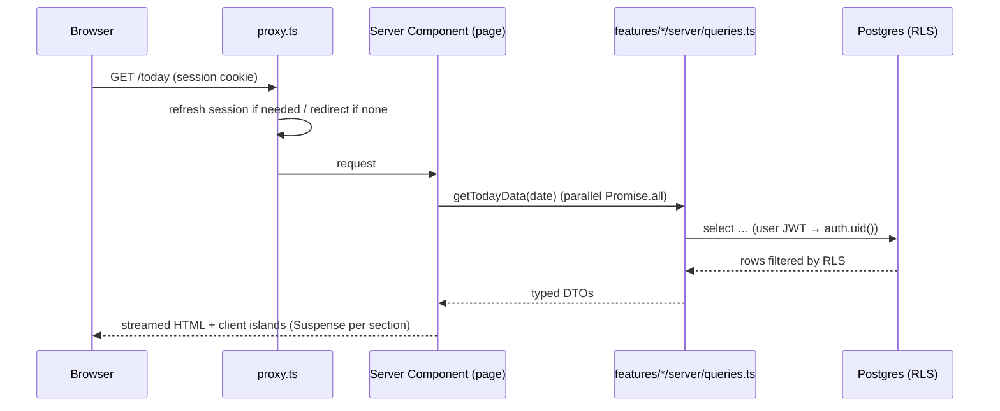
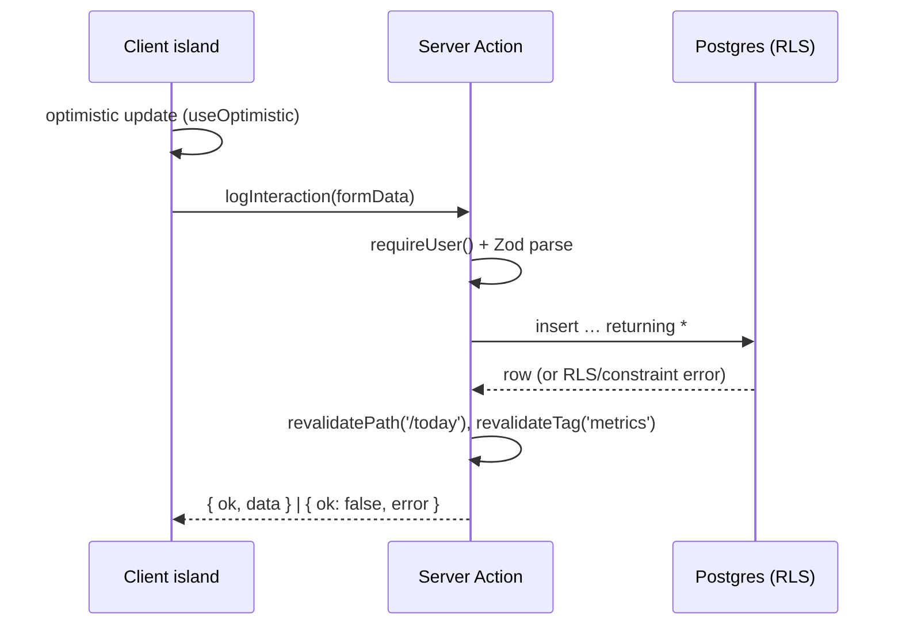
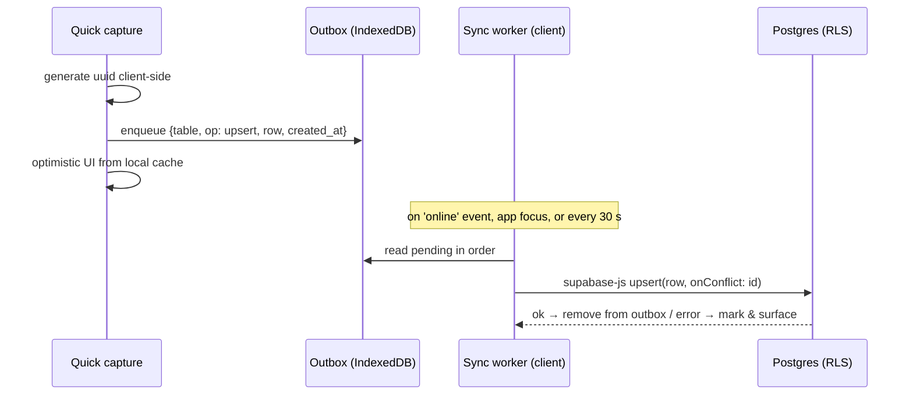
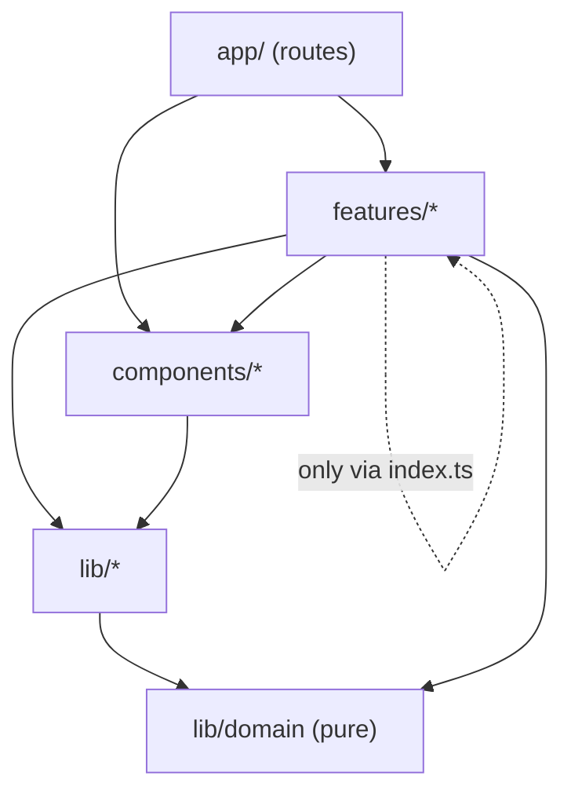

# 5. Component Architecture

## 1. Runtime architecture

| Layer | Technology | Responsibility |
|---|---|---|
| Client | React 19 (via Next.js), Tailwind CSS, shadcn/ui, Recharts | Rendering, interactive islands, optimistic UI, offline outbox |
| Server rendering | Next.js App Router, React Server Components | Authenticated reads with the user's session; no client data waterfalls |
| Mutations | Server Actions (forms/online), supabase-js direct (offline replay) | Validate with Zod, write through RLS, revalidate |
| Request guard | `proxy.ts` (`middleware.ts` before Next.js 16) with `@supabase/ssr` | Refresh the session cookie, redirect unauthenticated users to `/login` |
| Data | Supabase Postgres, RLS, views, RPC | Single source of truth and all aggregation |
| Background | `pg_cron` (in DB), GitHub Actions | Score snapshots, recurring task materialisation, reminders dispatch, backups |
| Notifications | Web Push (VAPID) from a Supabase Edge Function triggered by `pg_cron` | Morning/evening/weekly reminders and follow-ups |
| Hosting | Vercel (app), Supabase (DB/Auth/Storage) | |

### Read path



### Write path (online)



### Write path (offline capture)



**Why offline replay uses supabase-js rather than Server Actions:** Server Action IDs are tied to a specific build, so a capture queued before a deploy could fail to replay after it. supabase-js calls PostgREST, a stable API, with the user's JWT, so RLS still enforces ownership. Client-generated UUIDs make every replay idempotent.

Offline scope (NFR-09): quick capture of interactions, metric counters, habit check-ins, tasks, journal and ideas. Complex editing (pipeline drag, imports, reviews) requires a connection, and the UI says so.

## 2. PWA design

| Concern | Decision |
|---|---|
| Manifest | `src/app/manifest.ts` (Next.js built-in): name, icons (192/512 + maskable), `display: standalone`, theme colours, **shortcuts** (Log call → `/today?capture=call`, Quick capture, Today) |
| Service worker | Serwist (`@serwist/next`) generating `sw.js`. If the bundler setup makes that awkward, fall back to a hand-written `public/sw.js` as in the Next.js PWA guide. Decide in Milestone 0. |
| Caching | App shell and static assets: precache. Fonts and icons: cache-first. Navigations: network-first with an offline fallback page. **Authenticated API/HTML responses are not cached in the service worker** (privacy). Data for offline viewing lives in IndexedDB under the app's control. |
| Client data cache | TanStack Query with an IndexedDB persister, used only in the client islands that must work offline (Today counters, habits, capture). Server Components handle everything else. |
| Updates | "New version available — reload" toast when a new service worker is waiting. Never skip waiting silently during an unsent capture. |
| Logout | Clears the IndexedDB stores, the Query cache and the service worker's runtime caches |
| Install | Custom install prompt (Android/desktop `beforeinstallprompt`); an iOS "Add to Home Screen" hint sheet |
| Push | Web Push via VAPID. Subscriptions stored in `push_subscriptions`. iOS requires the PWA to be installed. |

## 3. Code organisation

```
fiveyearos/
├── src/
│   ├── app/                              # Routing only: thin pages, layouts, loading/error states
│   │   ├── (auth)/login/page.tsx
│   │   ├── auth/callback/route.ts
│   │   ├── (app)/layout.tsx              # AppShell: sidebar / bottom nav, capture sheet, command palette
│   │   ├── (app)/today/page.tsx
│   │   ├── (app)/sales/pipeline/page.tsx
│   │   ├── (app)/…                       # one folder per route in 03 §3.4
│   │   ├── manifest.ts
│   │   ├── layout.tsx                    # <html>, theme provider, fonts
│   │   └── global-error.tsx
│   │
│   ├── features/                         # Vertical slices: one folder per module
│   │   ├── today/
│   │   ├── capture/
│   │   ├── goals/
│   │   ├── metrics/
│   │   ├── habits/
│   │   ├── tasks/
│   │   ├── reviews/
│   │   ├── journal/
│   │   ├── sales/
│   │   │   ├── components/               # PipelineBoard, DealCard, CallOutcomePad, ContactTimeline…
│   │   │   ├── server/
│   │   │   │   ├── queries.ts            # 'server-only' reads (RSC)
│   │   │   │   └── actions.ts            # 'use server' mutations
│   │   │   ├── schemas.ts                # Zod schemas (shared client/server)
│   │   │   ├── types.ts                  # DTOs derived from generated DB types
│   │   │   ├── hooks/                    # client hooks (useLogCall, usePipelineDnD)
│   │   │   └── index.ts                  # public surface: the only file other features may import
│   │   ├── product/  brand/  wealth/  learning/  analytics/  settings/  onboarding/
│   │
│   ├── components/
│   │   ├── ui/                           # shadcn/ui primitives (generated, lightly themed)
│   │   ├── layout/                       # AppShell, Sidebar, BottomNav, PageHeader, ModuleTabs
│   │   ├── shared/                       # domain-agnostic composites (see §5)
│   │   └── charts/                       # Recharts wrappers (see §6)
│   │
│   ├── lib/
│   │   ├── supabase/                     # server.ts, client.ts, proxy.ts, admin.ts (scripts only)
│   │   ├── domain/                       # PURE TypeScript: no React, no Supabase, no Next
│   │   │   ├── periods.ts                # period boundaries, week start, journey day/year
│   │   │   ├── money.ts                  # minor units, formatting, FX conversion
│   │   │   ├── progress.ts               # KR progress, expected pace, goal health
│   │   │   ├── scoring.ts                # pillar & overall score (mirrors SQL v1 for previews)
│   │   │   ├── fi.ts                     # FI number, projections, debt payoff
│   │   │   ├── streaks.ts                # habit streaks & adherence
│   │   │   └── recurrence.ts             # RRULE expansion
│   │   ├── offline/                      # outbox.ts, idb.ts, sync.ts
│   │   ├── auth.ts                       # requireUser(), getUser()
│   │   ├── action.ts                     # createAction() wrapper: auth + zod + error mapping
│   │   └── utils.ts                      # cn(), etc.
│   │
│   ├── types/database.types.ts           # generated by Supabase CLI. Never hand-edited.
│   ├── proxy.ts                          # session refresh + route guard
│   └── sw.ts                             # service worker source (Serwist)
│
├── supabase/
│   ├── migrations/                       # timestamped SQL
│   ├── seed.sql                          # local dev data (synthetic)
│   ├── tests/                            # pgTAP: RLS, constraints, metric_series semantics
│   └── config.toml
├── e2e/                                  # Playwright journeys (J1–J7)
├── docs/                                 # this blueprint + adr/
└── .github/workflows/                    # ci.yml, backup.yml
```

### Dependency rules (enforced with ESLint `import/no-restricted-paths`)



1. `app/` contains no business logic. A page calls feature queries and renders feature components.
2. Features import other features only through their `index.ts`.
3. `lib/domain` imports nothing from React, Next.js or Supabase. That's what makes it trivially unit-testable.
4. `server/` files start with `import 'server-only'`. The secret (service-role) key appears only in `lib/supabase/admin.ts`, which is imported only by scripts and cron code, never by the request path.

## 4. Patterns

### Data fetching

- Pages are Server Components that fetch in parallel (`Promise.all`) and stream each section with `<Suspense>` and skeletons.
- All authenticated pages render dynamically per request. **User data is never put in a shared cache.** Next.js caching APIs (`use cache`, `unstable_cache`) are only used for non-user reference data.
- Analytics reads call RPCs (`metric_series`, `pillar_scorecard`) and get pre-aggregated series, never raw rows.

### Mutations

Every Server Action is created through one wrapper, so auth, validation and error shape are uniform:

```ts
// lib/action.ts (shape, not final code)
export const createAction = <S extends z.ZodTypeAny, R>(
  schema: S,
  handler: (input: z.infer<S>, ctx: { supabase: SupabaseClient; userId: string }) => Promise<R>,
  opts?: { revalidate?: string[] }
) => async (raw: unknown): Promise<ActionResult<R>> => { /* requireUser → parse → handler → revalidate */ };
```

Server Actions are public HTTP endpoints, so each one re-checks the user and validates input. RLS is the second line of defence, not the only one.

### State

| State kind | Tool |
|---|---|
| Server data | RSC props, refreshed by `revalidatePath`/`revalidateTag` |
| Offline-capable client data | TanStack Query + IndexedDB persister |
| Optimistic updates | React `useOptimistic` / Query `onMutate` |
| URL state (filters, grain, date range, tabs) | `nuqs` (type-safe search params), so views are bookmarkable |
| Forms | `react-hook-form` + `@hookform/resolvers/zod` using the feature's `schemas.ts` |
| Ephemeral UI (sheets, palette) | Local state / a small context; no global store needed |
| Theme | `next-themes` (class strategy, matches shadcn/ui) |

### Dates and money

- `date-fns` plus `@date-fns/tz`. The owner's timezone comes from `profiles.timezone`. "Today" is computed in that timezone, never the server's.
- Period helpers in `lib/domain/periods.ts` are the only place that knows how to turn a date into `{periodType, start, end}`. The same rules are mirrored in SQL and verified by shared test fixtures.
- Money is passed around as `{ amountMinor: bigint | number, currency }` and formatted with `Intl.NumberFormat`. Inputs parse to minor units on submit.

## 5. Shared component library

Built on shadcn/ui primitives (Button, Card, Dialog, Sheet, Drawer, Tabs, Command, Popover, Calendar, Form, Table, Badge, Progress, Tooltip, Sonner toasts).

| Component | Purpose | Used by |
|---|---|---|
| `AppShell`, `Sidebar`, `BottomNav`, `ModuleTabs`, `PageHeader` | Navigation chrome ([03 §3.3](03-user-journeys-and-navigation.md#33-navigation-model)) | All |
| `QuickCaptureSheet` | Type picker + per-type mini-forms; offline-aware | Global |
| `CommandPalette` | Navigation and actions (`⌘K`) | Global |
| `StatCard` | Value, delta vs previous period, sparkline, target progress | Dashboard, overviews |
| `MetricCounter` | Large +1/−1 counter with target ring (optimistic, offline) | Today |
| `TargetProgress` | Linear/radial progress with "expected pace" marker | Goals, Today |
| `PillarBadge`, `PillarScoreCard` | Pillar colour/icon; weekly score + trend | Everywhere |
| `PeriodPicker`, `GrainToggle`, `DateRangePicker` | Period navigation (week/month/quarter/year, journey year) | Analytics, reviews |
| `DataTable` | TanStack Table + shadcn Table: sort, filter, column visibility, virtualised rows | Contacts, transactions, content |
| `KanbanBoard` | Generic columns + drag-and-drop (dnd-kit), keyboard accessible | Pipeline, content board, ideas |
| `Timeline` | Chronological feed of mixed events | Contact detail, journey timeline |
| `CalendarMonth` / `CalendarWeek` | Calendar grids | Content calendar, habits |
| `HeatmapCalendar` | GitHub-style year grid (CSS grid; Recharts has none) | Habits, activity |
| `MarkdownEditor` / `MarkdownView` | Edit with preview; render with `rehype-sanitize` | Journal, notes, content, reviews |
| `MoneyInput`, `MoneyText` | Currency-aware input/display in minor units | Wealth, deals, subscriptions |
| `RatingInput` | 1–5 / 1–10 segmented input | Journal, reviews, skills |
| `EntityPicker` | Async combobox for contacts, deals, goals, products | Forms |
| `ReviewWizard` | Step engine rendering template questions from JSON | Reviews |
| `EmptyState`, `ErrorState`, `OfflineBanner`, `SyncStatus` | System states | All |

## 6. Charts (Recharts)

Recharts renders client-side, so every chart is a `'use client'` wrapper that receives **already-aggregated series** from the server as props and is lazy-loaded with `next/dynamic`. All charts share one theme (pillar colours via CSS variables, so light and dark both work) and come with an accessible data table toggle (NFR-13).

| Wrapper | Recharts base | Shows |
|---|---|---|
| `TrendChart` | `LineChart`/`AreaChart` + target `ReferenceLine` | Any metric over time vs target |
| `ComparisonBarChart` | `BarChart` (grouped) | This vs previous period; per pillar |
| `StackedAreaChart` | `AreaChart` stacked | Net worth composition, income by stream |
| `FunnelChart` | `FunnelChart` / horizontal `BarChart` | Sales funnel with conversion % labels |
| `ScoreRadar` | `RadarChart` | Pillar scores; skills matrix |
| `ProgressRing` | `RadialBarChart` | KR/goal progress, FI % |
| `Sparkline` | `LineChart` (no axes) | Inline trends in `StatCard` |
| `ScatterCorrelation` | `ScatterChart` | Metric vs metric exploration (AN-06) |
| `WaterfallChart` | `BarChart` with invisible base series | Monthly cash flow, net worth change |

## 7. Example composition: the Today page

```
app/(app)/today/page.tsx  (RSC)
└─ <TodayView date>                         features/today
   ├─ <JourneyHeader/>                     day 412 of 1,826 · Year 2 · week score
   ├─ <Suspense> <IntentionAndTop3/>       period_plans + tasks          (server form + optimistic toggle)
   ├─ <Suspense> <CounterRow/>             metric_definitions.show_on_today → <MetricCounter/> × n  (client, offline)
   ├─ <Suspense> <HabitChecklist/>         habits + habit_logs           (client, offline)
   ├─ <Suspense> <ScheduledTasks/>         tasks scheduled/due today
   ├─ <Suspense> <FollowUpsDue/>           v_follow_ups_due
   ├─ <Suspense> <ContentToday/>           content_items scheduled today
   └─ <ShutdownPrompt/>                    after local 18:00 → evening flow
```

## 8. Quality, testing and delivery

| Level | Tooling | Scope |
|---|---|---|
| Static | TypeScript `strict`, ESLint (incl. import boundaries), Prettier | Every commit |
| Unit | Vitest | `lib/domain` (≥ 80% coverage): periods, scoring, progress, FI, streaks, money, recurrence |
| Database | pgTAP via `supabase test db` | RLS isolation for every table (user A can't see/modify user B), constraints, `metric_series` flow/stock semantics, trigger behaviour |
| Component | Vitest + Testing Library | Forms, counters, wizard step logic |
| End-to-end | Playwright (mobile + desktop viewports) | Journeys J1–J7, offline capture replay, PWA installability |
| Accessibility | `@axe-core/playwright` in E2E | No serious/critical violations |
| Performance | Lighthouse CI on `/today` and `/dashboard` | NFR-01, NFR-04 budgets |

**CI (GitHub Actions)** on every PR: install → typecheck → lint → unit → start local Supabase → apply migrations + seed → pgTAP → check generated types are fresh → build → Playwright → Lighthouse. **CD:** Vercel preview per PR (pointing to a staging Supabase project). Merging to `main` deploys production, and migrations are applied by a gated workflow step (`supabase db push`) before the app deploy.

**Environments:** `local` (Supabase CLI in Docker) → `staging` (separate Supabase project, synthetic data) → `production`. Production data never leaves production except as encrypted backups.

**Observability:** error tracking (Sentry or similar) on client and server with PII scrubbing; Vercel Web Vitals; monthly review of Supabase query performance and advisors (security and performance lints).
