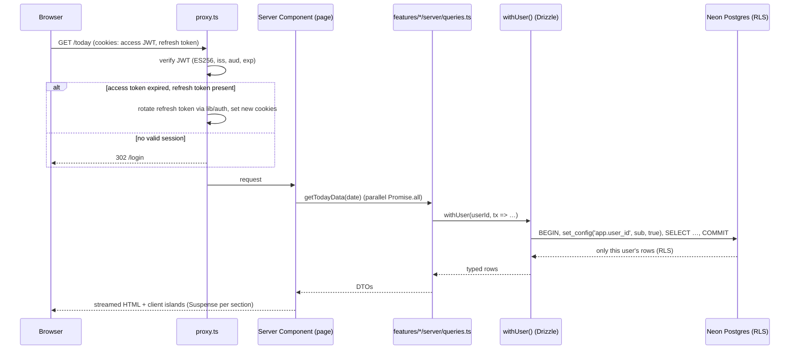
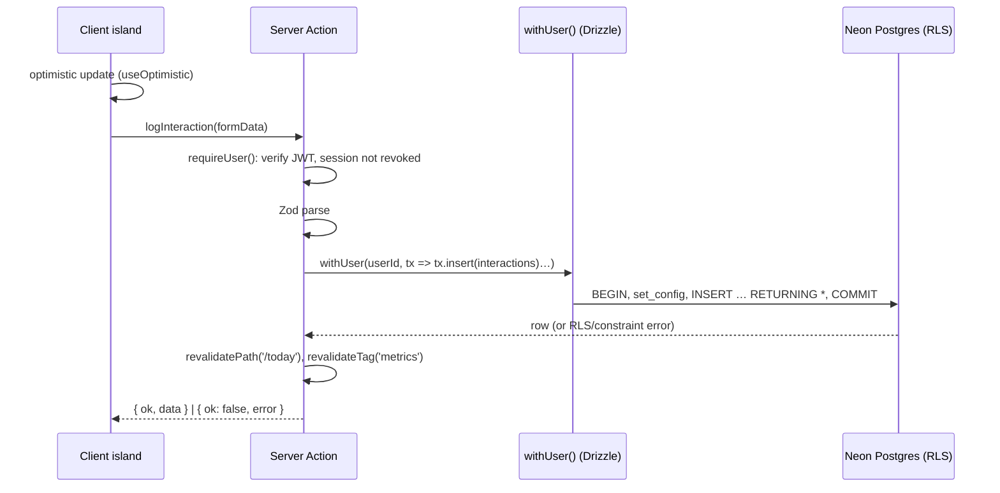
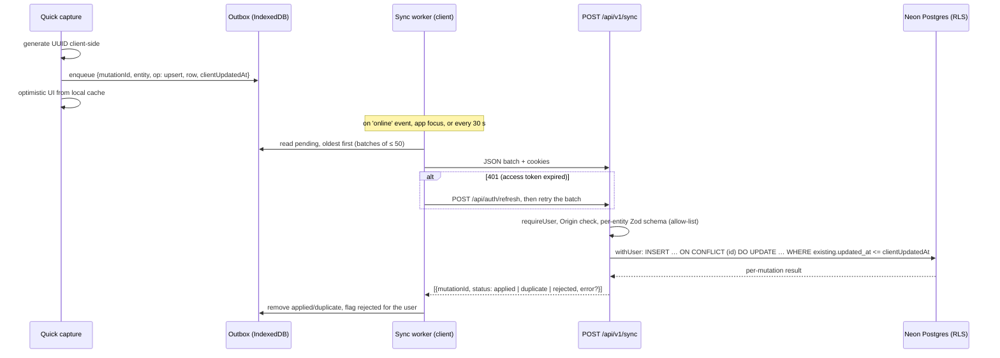
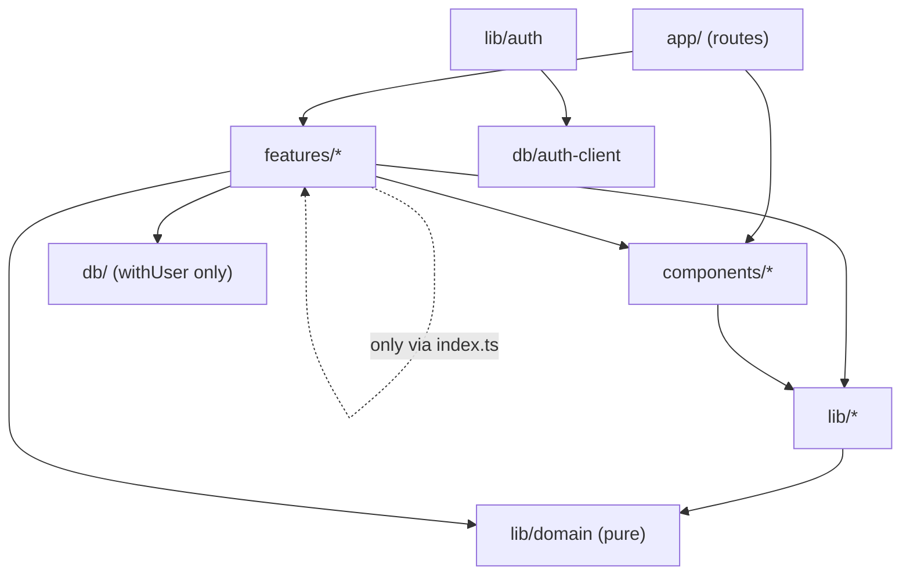

# 5. Component Architecture

## 1. Runtime architecture

| Layer | Technology | Responsibility |
|---|---|---|
| Client | React 19 (via Next.js), Tailwind CSS, shadcn/ui, Recharts | Rendering, interactive islands, optimistic UI, offline outbox |
| Request guard | `proxy.ts` (Next.js 16; `middleware.ts` on earlier versions), Node.js runtime | Verify the access JWT, refresh it from the refresh cookie when expired, redirect unauthenticated users to `/login` |
| Authentication | `lib/auth` + `/api/auth/*` route handlers, using `jose`, `@node-rs/argon2` and `otplib` | Password check, TOTP, issuing and verifying JWTs, refresh-token rotation, lockout ([06 §3](06-security.md#3-authentication-self-issued-jwt)) |
| Server rendering | Next.js App Router, React Server Components | Authenticated reads through the data access layer; no client data waterfalls |
| Mutations | Server Actions (online forms), `POST /api/v1/sync` (offline replay) | Validate with Zod, write through the data access layer, revalidate |
| Data access layer | Drizzle ORM, `pg` pool over Neon's **pooled** connection string, `withUser()` | Every query runs in a transaction that sets `app.user_id`, so Postgres RLS applies |
| Data | Neon serverless PostgreSQL 17 | Source of truth and all aggregation (views and SQL functions) |
| Background jobs | Vercel Cron → `/api/cron/[job]` (protected by `CRON_SECRET`); GitHub Actions | Score snapshots, recurring-task materialisation, reminders, FX rates, cleanup; CI and daily backups |
| Notifications | `web-push` (VAPID), sent from the reminders cron route | Morning, evening, weekly-review and follow-up reminders |
| Files | S3-compatible object storage (Cloudflare R2), presigned URLs | Attachments (post-v1 *could* feature) |
| Hosting | Vercel (app), Neon (database) | |

### Neon connection model

| Concern | Decision |
|---|---|
| Runtime connection | Neon **pooled** endpoint (PgBouncer, transaction mode) over TLS, as role `fyos_app`. A module-scoped `pg` pool is reused across invocations on Vercel's Node.js runtime. |
| Driver | `drizzle-orm/node-postgres`. Neon's serverless driver over WebSockets (`@neondatabase/serverless` `Pool`) is an equivalent drop-in. Choose in M0 by measuring latency from the Vercel region. Both support interactive transactions, which `withUser()` needs. The Neon HTTP driver does not, so it is not used. |
| Why transaction pooling is safe | `set_config('app.user_id', …, true)` is **transaction-local**, so a pooled backend never carries one request's identity into another. Session-level `SET` is forbidden (lint rule + code review). |
| Region | The Neon project and Vercel functions run in the same region. |
| Cold starts | On plans that scale to zero, the first query after an idle period wakes the compute, which typically takes well under a second. That's acceptable for a personal app. If the morning first-open feels slow, raise the suspend timeout or disable scale-to-zero on a paid plan. |
| Migrations and backups | Neon **direct** (unpooled) endpoint as `fyos_owner`, from CI only |

### Read path



### Write path (online)



### Write path (offline capture)



**Why a versioned route handler instead of Server Actions:** Server Action IDs are tied to a specific build, so a capture queued before a deploy could fail to replay after it. `/api/v1/sync` is a stable, versioned contract. Client-generated UUIDs make every replay idempotent. Last-write-wins on `updated_at` is enough for a single owner.

Offline scope (NFR-09) is the entities allowed in the sync API: interactions, metric entries, habit logs, tasks, journal entries, ideas and content ideas. Complex editing (pipeline drag, imports, reviews) requires a connection, and the UI says so.

## 2. PWA design

| Concern | Decision |
|---|---|
| Manifest | `src/app/manifest.ts` (Next.js built-in): name, icons (192/512 + maskable), `display: standalone`, theme colours, **shortcuts** (Log call → `/today?capture=call`, Quick capture, Today) |
| Service worker | Serwist (`@serwist/next`) generating `sw.js`. If the bundler setup makes that awkward, fall back to a hand-written `public/sw.js` as in the Next.js PWA guide. Decide in Milestone 0. |
| Caching | App shell and static assets: precache. Fonts and icons: cache-first. Navigations: network-first with an offline fallback page. **Authenticated HTML and API responses are never cached by the service worker** (privacy). Data for offline viewing lives in IndexedDB under the app's control. |
| Auth and offline | Auth cookies are HTTP-only, so neither JavaScript nor the service worker can read them. Offline captures are queued without a token and sent when online, when the browser attaches cookies automatically. If the session has fully expired, the outbox is kept and replayed after the next login. |
| Client data cache | TanStack Query with an IndexedDB persister, used only in the client islands that must work offline (Today counters, habits, capture). Server Components handle everything else. |
| Updates | "New version available — reload" toast when a new service worker is waiting. Never skip waiting silently during an unsent capture. |
| Logout | Revokes the server session, clears cookies, IndexedDB stores, the Query cache and the service worker's runtime caches. The logout dialog warns if the outbox still holds unsynced captures. |
| Install | Custom install prompt (Android/desktop `beforeinstallprompt`); an iOS "Add to Home Screen" hint sheet |
| Push | Web Push via VAPID. Subscriptions stored in `push_subscriptions`. iOS requires the PWA to be installed. |

## 3. Code organisation

```
fiveyearos/
├── src/
│   ├── app/                              # Routing only: thin pages, layouts, loading/error states
│   │   ├── (auth)/login/page.tsx         # + login/mfa, login/mfa/setup
│   │   ├── (app)/layout.tsx              # AppShell: sidebar / bottom nav, capture sheet, command palette
│   │   ├── (app)/today/page.tsx
│   │   ├── (app)/sales/pipeline/page.tsx
│   │   ├── (app)/…                       # one folder per route in 03 §3.4
│   │   ├── api/auth/[action]/route.ts    # login · mfa · refresh · logout (POST only)
│   │   ├── api/v1/sync/route.ts          # offline replay
│   │   ├── api/cron/[job]/route.ts       # score-snapshots · recurring-tasks · reminders · fx-rates · cleanup
│   │   ├── manifest.ts
│   │   ├── layout.tsx                    # <html>, theme provider, fonts
│   │   └── global-error.tsx
│   │
│   ├── features/                         # Vertical slices: one folder per module
│   │   ├── today/  capture/  goals/  metrics/  habits/  tasks/  reviews/  journal/
│   │   ├── sales/
│   │   │   ├── components/               # PipelineBoard, DealCard, CallOutcomePad, ContactTimeline…
│   │   │   ├── server/
│   │   │   │   ├── queries.ts            # 'server-only' reads, always via withUser()
│   │   │   │   └── actions.ts            # 'use server' mutations built with createAction()
│   │   │   ├── schemas.ts                # Zod schemas (shared client/server, reused by the sync API)
│   │   │   ├── types.ts                  # DTOs derived from Drizzle row types
│   │   │   ├── hooks/                    # client hooks (useLogCall, usePipelineDnD)
│   │   │   └── index.ts                  # public surface: the only file other features may import
│   │   ├── product/  brand/  wealth/  learning/  analytics/  settings/  onboarding/
│   │
│   ├── db/
│   │   ├── schema/                       # Drizzle table definitions per domain: the source of truth
│   │   │   ├── auth.ts  core.ts  strategy.ts  metrics.ts  execution.ts  rituals.ts
│   │   │   └── sales.ts  product.ts  brand.ts  wealth.ts  learning.ts  shared.ts
│   │   ├── client.ts                     # pooled connection as fyos_app (server-only)
│   │   ├── with-user.ts                  # withUser(userId, fn): transaction + set_config('app.user_id')
│   │   └── auth-client.ts                # separate pool as fyos_auth: importable ONLY from lib/auth
│   │
│   ├── components/
│   │   ├── ui/                           # shadcn/ui primitives (generated, lightly themed)
│   │   ├── layout/                       # AppShell, Sidebar, BottomNav, PageHeader, ModuleTabs
│   │   ├── shared/                       # domain-agnostic composites (see §5)
│   │   └── charts/                       # Recharts wrappers (see §6)
│   │
│   ├── lib/
│   │   ├── auth/                         # server-only
│   │   │   ├── jwt.ts                    # sign/verify access + MFA-challenge tokens (jose, ES256, kid)
│   │   │   ├── password.ts               # argon2id hash/verify, dummy-hash timing equaliser
│   │   │   ├── totp.ts                   # otplib verify (±1 step, replay guard), secret encryption
│   │   │   ├── sessions.ts               # create, rotate (grace window), revoke, reuse detection
│   │   │   ├── cookies.ts                # __Host- cookie names and attributes in one place
│   │   │   ├── rate-limit.ts             # fixed-window limiter on auth.rate_limits
│   │   │   └── require-user.ts           # requireUser(): JWT + session check, React cache() per request
│   │   ├── domain/                       # PURE TypeScript: no React, no DB, no Next
│   │   │   ├── periods.ts                # period boundaries, week start, journey day/year
│   │   │   ├── money.ts                  # minor units, formatting, FX conversion
│   │   │   ├── progress.ts               # KR progress, expected pace, goal health
│   │   │   ├── scoring.ts                # pillar & overall score (mirrors SQL v1 for previews)
│   │   │   ├── fi.ts                     # FI number, projections, debt payoff
│   │   │   ├── streaks.ts                # habit streaks & adherence
│   │   │   └── recurrence.ts             # RRULE expansion
│   │   ├── offline/                      # outbox.ts, idb.ts, sync.ts
│   │   ├── storage/                      # presign.ts (S3-compatible client)
│   │   ├── action.ts                     # createAction(): auth + Zod + withUser + error mapping
│   │   ├── cron.ts                       # verifyCronRequest(), forEachUser(job)
│   │   └── utils.ts                      # cn(), etc.
│   │
│   ├── proxy.ts                          # JWT verify + refresh + route guard
│   └── sw.ts                             # service worker source (Serwist)
│
├── drizzle/
│   └── migrations/                       # generated + custom SQL (RLS, grants, views, functions, triggers)
├── drizzle.config.ts
├── scripts/                              # owner-only CLIs, run with fyos_owner credentials
│   ├── create-owner.ts                   # creates the single auth.users row, prints MFA setup link
│   ├── reset-owner.ts                    # reset password and/or MFA (account recovery)
│   ├── rotate-jwt-key.ts                 # generates a new ES256 key pair (kid) for rotation
│   └── seed-dev.ts                       # synthetic data for dev/CI branches
├── tests/
│   ├── integration/                      # Vitest against a Neon branch / Postgres 17: RLS isolation, constraints, metric_series
│   └── auth/                             # token, rotation, reuse, lockout, CSRF tests
├── e2e/                                  # Playwright journeys (J1–J7)
├── docs/                                 # this blueprint + adr/
├── vercel.json                           # cron schedules
└── .github/workflows/                    # ci.yml, backup.yml
```

### Dependency rules (enforced with ESLint `import/no-restricted-paths`)



1. `app/` contains no business logic. A page calls feature queries and renders feature components.
2. Features import other features only through their `index.ts`.
3. `lib/domain` imports nothing from React, Next.js or the database. That's what makes it trivially unit-testable.
4. **Database access goes through `withUser()` only.** Importing `db/client` outside `db/` and `lib/` is a lint error. Only `lib/auth` may import `db/auth-client`.
5. Everything under `server/`, `db/` and `lib/auth/` starts with `import 'server-only'`. No database URL or signing key can ever end up in a client bundle.

## 4. Patterns

### Data fetching

- Pages are Server Components that fetch in parallel (`Promise.all`) and stream each section with `<Suspense>` and skeletons.
- `requireUser()` is wrapped in React `cache()`, so one request does one JWT verification and one session lookup however many components ask.
- All authenticated pages render dynamically per request. **User data is never put in a shared cache.** Next.js caching APIs (`use cache`, `unstable_cache`) are only used for non-user reference data.
- Analytics reads call SQL functions (`metric_series`, `pillar_scorecard`) and get pre-aggregated series, never raw rows.

### Data access

```ts
// db/with-user.ts (shape, not final code)
export async function withUser<T>(userId: string, fn: (tx: Tx) => Promise<T>): Promise<T> {
  return db.transaction(async (tx) => {
    await tx.execute(sql`select set_config('app.user_id', ${userId}, true)`); // transaction-local
    return fn(tx);
  });
}
```

### Mutations

Every Server Action is created through one wrapper, so auth, validation, user scoping and error shape are uniform:

```ts
// lib/action.ts (shape, not final code)
export const createAction = <S extends z.ZodTypeAny, R>(
  schema: S,
  handler: (input: z.infer<S>, ctx: { tx: Tx; userId: string }) => Promise<R>,
  opts?: { revalidate?: string[] }
) => async (raw: unknown): Promise<ActionResult<R>> => {
  /* requireUser() → schema.parse → withUser(userId, tx => handler(input, { tx, userId })) → revalidate */
};
```

Server Actions are public HTTP endpoints, so each one re-checks the user and validates input. RLS is the second line of defence, not the only one.

### Scheduled jobs

`vercel.json` declares the schedules. Each `/api/cron/[job]` handler calls `verifyCronRequest()` (Vercel sends `Authorization: Bearer $CRON_SECRET`) and then `forEachUser(userId => withUser(userId, …))`, so jobs run under RLS like any request. The list of user ids comes from a single `security definer` function, `app.list_user_ids()`, which is the only RLS exception and is documented in [06 §4](06-security.md#4-authorisation-row-level-security). Jobs are idempotent (keyed on period or date), so a retried or doubled run is harmless.

| Job | Schedule | Notes |
|---|---|---|
| `score-snapshots` | Mondays 03:00 (owner timezone) | Fills any week without a snapshot |
| `recurring-tasks` | Daily 02:00 | Materialises recurring tasks 14 days ahead |
| `reminders` | Every 15 min | Sends due reminders (±15 min accuracy is acceptable) |
| `fx-rates` | Daily | Only if a non-base currency is in use |
| `cleanup` | Nightly | Purges old `auth.rate_limits`, expired sessions, orphan taggings |

Frequent schedules (every 15 minutes) need a Vercel plan that allows them, because the free tier restricts cron frequency. Fallbacks are a GitHub Actions schedule or folding reminders into a daily digest.

### State

| State kind | Tool |
|---|---|
| Server data | RSC props, refreshed by `revalidatePath`/`revalidateTag` |
| Offline-capable client data | TanStack Query + IndexedDB persister |
| Optimistic updates | React `useOptimistic` / Query `onMutate` |
| URL state (filters, grain, date range, tabs) | `nuqs` (type-safe search params), so views are bookmarkable |
| Forms | `react-hook-form` + `@hookform/resolvers/zod` using the feature's `schemas.ts` |
| Ephemeral UI (sheets, palette) | Local state / a small context; no global store needed |
| Theme | `next-themes` (class strategy, matches shadcn/ui) |
| Auth state on the client | None stored. The server renders with the user. A `/api/auth/refresh` call recovers from a 401 on client fetches. |

### Dates and money

- `date-fns` plus `@date-fns/tz`. The owner's timezone comes from `profiles.timezone`. "Today" is computed in that timezone, never the server's.
- Period helpers in `lib/domain/periods.ts` are the only place that knows how to turn a date into `{periodType, start, end}`. The same rules are mirrored in SQL and verified by shared test fixtures.
- Money is passed around as `{ amountMinor: bigint | number, currency }` and formatted with `Intl.NumberFormat`. Inputs parse to minor units on submit. Drizzle `bigint` columns use `mode: 'number'` (safe up to 2⁵³ minor units).

## 5. Shared component library

Built on shadcn/ui primitives (Button, Card, Dialog, Sheet, Drawer, Tabs, Command, Popover, Calendar, Form, Table, Badge, Progress, Tooltip, Sonner toasts).

| Component | Purpose | Used by |
|---|---|---|
| `AppShell`, `Sidebar`, `BottomNav`, `ModuleTabs`, `PageHeader` | Navigation chrome ([03 §3.3](03-user-journeys-and-navigation.md#33-navigation-model)) | All |
| `LoginForm`, `MfaChallenge`, `MfaSetup` (QR + recovery codes), `SessionList` | Authentication screens and Settings → Security | Auth, settings |
| `QuickCaptureSheet` | Type picker + per-type mini-forms; offline-aware | Global |
| `CommandPalette` | Navigation and actions (`⌘K`) | Global |
| `StatCard` | Value, delta vs previous period, sparkline, target progress | Dashboard, overviews |
| `MetricCounter` | Large +1/−1 counter with target ring (optimistic, offline) | Today |
| `TargetProgress` | Linear/radial progress with "expected pace" marker | Goals, Today |
| `PillarBadge`, `PillarScoreCard` | Pillar colour/icon; weekly score + trend | Everywhere |
| `PeriodPicker`, `GrainToggle`, `DateRangePicker` | Period navigation (week/month/quarter/year, journey year) | Analytics, reviews |
| `DataTable` | TanStack Table + shadcn Table: sort, filter, column visibility, virtualised rows | Contacts, transactions, content |
| `KanbanBoard` | Generic columns + drag-and-drop (dnd-kit), keyboard accessible | Pipeline, content board, ideas |
| `Timeline` | Chronological feed of mixed events | Contact detail, journey timeline |
| `CalendarMonth` / `CalendarWeek` | Calendar grids | Content calendar, habits |
| `HeatmapCalendar` | GitHub-style year grid (CSS grid; Recharts has none) | Habits, activity |
| `MarkdownEditor` / `MarkdownView` | Edit with preview; render with `rehype-sanitize` | Journal, notes, content, reviews |
| `MoneyInput`, `MoneyText` | Currency-aware input/display in minor units | Wealth, deals, subscriptions |
| `RatingInput` | 1–5 / 1–10 segmented input | Journal, reviews, skills |
| `EntityPicker` | Async combobox for contacts, deals, goals, products | Forms |
| `ReviewWizard` | Step engine rendering template questions from JSON | Reviews |
| `EmptyState`, `ErrorState`, `OfflineBanner`, `SyncStatus` | System states | All |

## 6. Charts (Recharts)

Recharts renders client-side, so every chart is a `'use client'` wrapper that receives **already-aggregated series** from the server as props and is lazy-loaded with `next/dynamic`. All charts share one theme (pillar colours via CSS variables, so light and dark both work) and come with an accessible data table toggle (NFR-13).

| Wrapper | Recharts base | Shows |
|---|---|---|
| `TrendChart` | `LineChart`/`AreaChart` + target `ReferenceLine` | Any metric over time vs target |
| `ComparisonBarChart` | `BarChart` (grouped) | This vs previous period; per pillar |
| `StackedAreaChart` | `AreaChart` stacked | Net worth composition, income by stream |
| `FunnelChart` | `FunnelChart` / horizontal `BarChart` | Sales funnel with conversion % labels |
| `ScoreRadar` | `RadarChart` | Pillar scores; skills matrix |
| `ProgressRing` | `RadialBarChart` | KR/goal progress, FI % |
| `Sparkline` | `LineChart` (no axes) | Inline trends in `StatCard` |
| `ScatterCorrelation` | `ScatterChart` | Metric vs metric exploration (AN-06) |
| `WaterfallChart` | `BarChart` with invisible base series | Monthly cash flow, net worth change |

## 7. Example composition: the Today page

```
app/(app)/today/page.tsx  (RSC)
└─ <TodayView date>                         features/today
   ├─ <JourneyHeader/>                     day 412 of 1,826 · Year 2 · week score
   ├─ <Suspense> <IntentionAndTop3/>       period_plans + tasks          (server form + optimistic toggle)
   ├─ <Suspense> <CounterRow/>             metric_definitions.show_on_today → <MetricCounter/> × n  (client, offline)
   ├─ <Suspense> <HabitChecklist/>         habits + habit_logs           (client, offline)
   ├─ <Suspense> <ScheduledTasks/>         tasks scheduled/due today
   ├─ <Suspense> <FollowUpsDue/>           v_follow_ups_due
   ├─ <Suspense> <ContentToday/>           content_items scheduled today
   └─ <ShutdownPrompt/>                    after local 18:00 → evening flow
```

## 8. Quality, testing and delivery

| Level | Tooling | Scope |
|---|---|---|
| Static | TypeScript `strict`, ESLint (incl. import boundaries and the DB-access rule), Prettier | Every commit |
| Unit | Vitest | `lib/domain` (≥ 80% coverage): periods, scoring, progress, FI, streaks, money, recurrence |
| Auth | Vitest | `lib/auth` (≥ 90% coverage): JWT verify rejects tampered, expired, wrong-`aud`, `alg: none`/HS256-swap tokens; refresh rotation, grace window, reuse → revoke; lockout and rate limits; TOTP replay; recovery codes single-use |
| Database integration | Vitest + `pg` against an ephemeral Neon branch (or a Postgres 17 container locally) | RLS isolation for every table (user A can't see or change user B's rows, and no `app.user_id` means no rows), `fyos_app` cannot read `auth.*` or run DDL, constraints, `metric_series` flow/stock semantics, triggers |
| Component | Vitest + Testing Library | Forms, counters, wizard step logic |
| End-to-end | Playwright (mobile + desktop viewports) | Login + MFA + refresh + logout, journeys J1–J7, offline capture replay, PWA installability |
| Accessibility | `@axe-core/playwright` in E2E | No serious/critical violations |
| Performance | Lighthouse CI on `/today` and `/dashboard` | NFR-01, NFR-04 budgets |

**CI (GitHub Actions)** on every PR: install → typecheck → lint → unit + auth tests → **create Neon branch** (`neondatabase/create-branch-action`) from the synthetic-data branch → `drizzle-kit migrate` as `fyos_owner` → seed → integration tests as `fyos_app` → `drizzle-kit check` → build → Playwright → Lighthouse → delete branch.

**CD:** a Vercel preview per PR, each with its own Neon branch (Neon–Vercel integration), so previews never touch production data. On merge to `main`, a gated workflow step applies migrations to the production branch, then Vercel deploys. Migrations follow expand/contract ([04 §9](04-database-architecture.md#9-migrations-and-schema-evolution)), so the old app version keeps working during the deploy.

**Environments:** `local` (Neon `dev` branch or a Postgres 17 container) → `preview` (Neon branch per PR, synthetic data) → `production` (Neon `main` branch). Production data never leaves production except as encrypted backups.

**Observability:** error tracking (Sentry or similar) on client and server with PII and token scrubbing; Vercel Web Vitals; `pg_stat_statements` and Neon monitoring reviewed monthly; `auth.events` surfaced in Settings → Security.
