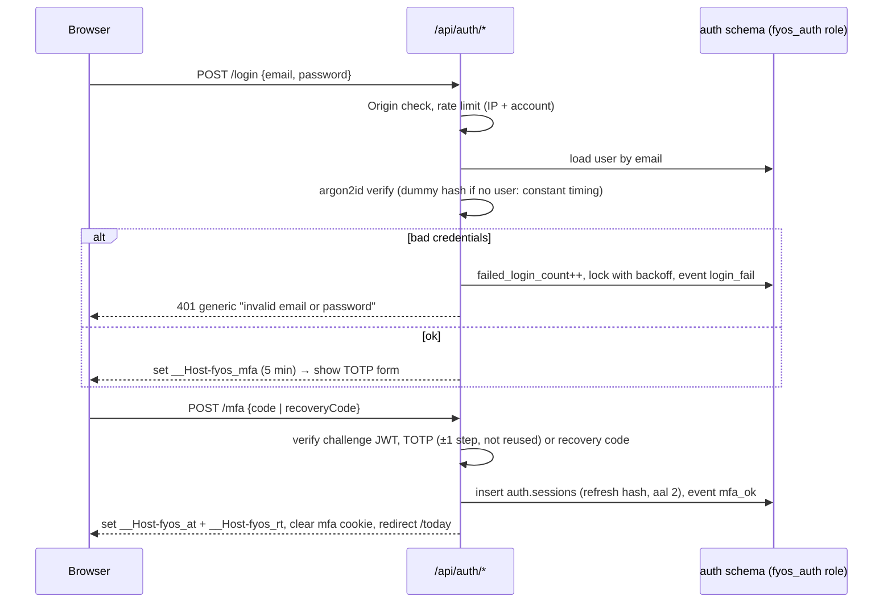

# 6. Security Requirements

## 1. What we are protecting

| Asset | Sensitivity | Examples |
|---|---|---|
| Financial data | High | Balances, debts, income, transactions |
| Third-party personal data | High | Prospects' and customers' names, phones, emails, call notes |
| Private reflections | High | Journal, reviews, lessons, setbacks |
| Business strategy | Medium | Ideas, pipeline values, product plans |
| Credentials and secrets | Critical | Password hash, TOTP secret, JWT signing key, refresh tokens, database role passwords |

## 2. Threat model (summary)

| Threat | Vector | Primary controls |
|---|---|---|
| Account takeover | Phished or reused password | Mandatory TOTP MFA, argon2id hashing, lockout with backoff, IP rate limits, login alerts in `auth.events` |
| Token theft | XSS reading tokens, stolen device, leaked logs | Tokens only in `HttpOnly` `__Host-` cookies (never `localStorage`), 15-minute access tokens, refresh-token rotation with reuse detection, sign-out-everywhere, token scrubbing in logs |
| Token forgery | Algorithm confusion, `alg: none`, missing claim checks, weak secret | ES256 asymmetric signing with `jose`, algorithm pinned on verify, `iss`/`aud`/`exp` required, `kid`-based key rotation |
| Unauthorised account creation | Someone registers on the public URL | **No sign-up endpoint exists.** The single account is created by an owner-only CLI. |
| Bugs in self-built auth | Logic errors in login, refresh or MFA | Small surface (no sign-up, OAuth, email links or password-reset emails), vetted primitives, dedicated test suite (≥ 90% coverage), release checklist (§10) |
| Data leakage between users | Missing `where user_id = …`, SQL injection | The database is reachable only from the server. Every query runs in `withUser()`. RLS on 100% of `public` tables fails closed. Least-privilege roles mean the runtime role cannot read `auth.*` or run DDL. |
| Database credential exposure | Leaked connection string | Strong generated role passwords, TLS required, runtime role has DML only, separate auth role, no URLs in client bundles, rotation runbook |
| XSS | Markdown in journal, notes, content | Sanitised rendering (`rehype-sanitize`), no `dangerouslySetInnerHTML` on user content, strict nonce-based CSP |
| CSRF | Cross-site form or fetch posts | `SameSite=Lax` cookies, built-in Origin check on Server Actions, Origin check + JSON-only bodies on route handlers, no state-changing `GET` |
| Injection | Search and filter input | Drizzle parameterised queries; `sql` template tag only, never string-concatenated SQL |
| Data loss | Accidental delete, bad migration, provider incident | Archive-not-delete, expand/contract migrations, Neon point-in-time restore, daily off-site encrypted dumps, restore drills |
| Lost or stolen phone | Offline cache on device | Device lock (OS), logout clears IndexedDB and caches, nothing sensitive in service-worker caches, remote session revocation |
| Supply chain | Malicious dependency | Lockfile, Dependabot/Renovate, `npm audit` in CI, minimal dependency set |

## 3. Authentication (self-issued JWT)

FiveYearOS issues and verifies its own tokens. With one owner, no sign-up and no third-party login, the auth surface is small enough to own completely, provided it is built only from vetted primitives and tested hard. Rationale and alternatives: [ADR-001](adr/ADR-001-jwt-auth-and-neon.md).

### 3.1 Building blocks

| Concern | Choice |
|---|---|
| JWT signing and verification | `jose`, **ES256** (ECDSA P-256), `kid` header for key rotation |
| Password hashing | argon2id via `@node-rs/argon2`, OWASP baseline parameters (m = 19 MiB, t = 2, p = 1), re-hashed on login if parameters are raised |
| Second factor | TOTP (RFC 6238) via `otplib`: 30-second step, ±1 step tolerance, replay blocked via `mfa_last_used_step` |
| TOTP secret at rest | AES-256-GCM with `AUTH_ENCRYPTION_KEY` (env), random 96-bit nonce per encryption |
| Refresh tokens | 256-bit random from `crypto.getRandomValues`, base64url. Opaque, not a JWT. Stored only as a SHA-256 hash. |
| Recovery codes | 10 random codes, argon2id-hashed, single-use |

### 3.2 Tokens and cookies

| Token | Format | Lifetime | Cookie | Contents |
|---|---|---|---|---|
| Access token | JWT (ES256) | **15 min** | `__Host-fyos_at`: `HttpOnly; Secure; SameSite=Lax; Path=/` | `iss`, `aud`, `sub` (user id), `sid` (session id), `ver` (`token_version`), `aal: 2`, `amr: ["pwd","otp"]`, `iat`, `exp`, `jti` |
| Refresh token | Opaque random | 30 days sliding, **90 days absolute** | `__Host-fyos_rt`: `HttpOnly; Secure; SameSite=Lax; Path=/` | None (looked up by hash in `auth.sessions`) |
| MFA challenge | JWT (ES256), `purpose: "mfa"`, `aal: 1` | 5 min | `__Host-fyos_mfa`: same attributes | `sub`, `purpose`, `exp`. Accepted **only** by `/api/auth/mfa`. |

The `__Host-` prefix forces `Secure`, `Path=/` and no `Domain`, so subdomains cannot set or overwrite the cookies. JavaScript never sees a token.

### 3.3 Flows



| Flow | Rules |
|---|---|
| First login | The owner CLI creates the user with a password. On first login, the only reachable page is `/login/mfa/setup`: show a QR code, confirm one code, display the recovery codes once. No full session is issued until MFA is enrolled. |
| Refresh | Runs in `proxy.ts` (on page navigations) and `POST /api/auth/refresh` (client fetches that got a 401). Hash the presented token and find the session. If it matches `refresh_token_hash`, **rotate**: new token and hash, keep the old hash as `previous_refresh_token_hash`, extend the sliding expiry and issue a new access token. If it matches the previous hash **within a 30-second grace window** (parallel tabs or requests), issue an access token without rotating again. If it matches the previous hash **after** the window, that's **reuse**: revoke the session, log `reuse_detected` and force a login. Expired, revoked, absolute-expired or `token_version` mismatch → 401 and cookies cleared. |
| Request authorisation | `proxy.ts` verifies the access token's signature and claims only, with no database call, to keep navigation fast. `requireUser()` in every Server Action, route handler and protected page also confirms the session is not revoked and `ver` equals `users.token_version`. That is one indexed query, cached per request. Sign-out therefore takes effect immediately for all data access, not after 15 minutes. |
| Logout | `POST /api/auth/logout`: revoke the session, clear cookies, client wipes IndexedDB and caches |
| Logout everywhere | Revoke all sessions and bump `token_version` |
| Password change | Requires the current password and a TOTP code. Bumps `token_version`, so every other device is signed out. |
| Account recovery | Recovery code instead of TOTP at `/login/mfa`. Lost both → `scripts/reset-owner.ts`, run by the owner with `fyos_owner` credentials. No email-based reset exists, so there is no email-takeover path. |

### 3.4 Requirements

| ID | Requirement |
|---|---|
| SEC-AUTH-01 | Email + password (min 12 characters, checked against a breached-password list such as the k-anonymity Pwned Passwords API at set/change time), hashed with argon2id. |
| SEC-AUTH-02 | **TOTP MFA is mandatory.** Only tokens with `aal: 2` grant access to the app. |
| SEC-AUTH-03 | No sign-up route. Exactly one owner, created by `scripts/create-owner.ts`. |
| SEC-AUTH-04 | Access tokens are ES256 JWTs. Verification pins `algorithms: ['ES256']` and requires `iss`, `aud` and `exp`, with ≤ 5 s clock tolerance. Tokens with an unknown `kid` are rejected. |
| SEC-AUTH-05 | Signing keys: private JWK in `AUTH_JWT_PRIVATE_JWK`, public JWKS (current + previous) in `AUTH_JWT_PUBLIC_JWKS`. Rotate yearly: publish the new public key, switch signing, and remove the old key after ≥ 15 minutes (one access-token lifetime). |
| SEC-AUTH-06 | Tokens live only in `HttpOnly; Secure; SameSite=Lax` `__Host-` cookies. Never in `localStorage`, `sessionStorage`, IndexedDB, URLs or logs. |
| SEC-AUTH-07 | Refresh tokens rotate on every use, are stored only as SHA-256 hashes, and reuse after the 30 s grace window revokes the session. |
| SEC-AUTH-08 | Lockout: after 5 consecutive failures, lock for 1 → 5 → 15 → 60 minutes (doubling, capped). IP rate limit: 20 auth requests per 10 minutes per /24 (IPv4) or /56 (IPv6) prefix, stored in `auth.rate_limits`. |
| SEC-AUTH-09 | Login errors and timings never reveal whether an email exists (generic message plus a dummy argon2 verify). |
| SEC-AUTH-10 | Every auth event is written to `auth.events` and visible in Settings → Security, with a list of active sessions that can be revoked individually. |
| SEC-AUTH-11 | Auth route handlers accept only `POST` with `Content-Type: application/json` and an `Origin` header equal to the app origin. |
| SEC-AUTH-12 | Changes to `lib/auth` require the auth test suite to pass and the §10 checklist to be completed in the PR. |

## 4. Authorisation: row-level security

The browser never connects to the database. RLS is still enforced on every table, as **defence in depth** against application bugs and injection: a query that forgets its `where user_id = …` still can't return another user's rows.

### 4.1 Roles

| Role | Used by | Privileges |
|---|---|---|
| `fyos_owner` | CI migrations, daily backup, owner CLIs | Owns every schema object. As owner it bypasses RLS (app tables do not use `FORCE ROW LEVEL SECURITY`), which lets `pg_dump` see all rows. **Never used by the running app.** Direct connection only. |
| `fyos_app` | The Next.js runtime: pages, actions, sync API, cron routes | `SELECT, INSERT, UPDATE, DELETE` on `public` tables (minus the insert-only exceptions), `EXECUTE` on `app` functions. No access to the `auth` schema, no DDL, no `BYPASSRLS`. Pooled connection. |
| `fyos_auth` | `lib/auth` only | `SELECT, INSERT, UPDATE` on `auth.*` (no `DELETE` except via the cleanup function), `INSERT` into `public.profiles` at owner creation. No access to other `public` tables. Pooled connection. |

### 4.2 Mechanism

```sql
create schema app;

-- Current user for this transaction, set by withUser(). NULL if unset → policies match nothing.
create function app.current_user_id() returns uuid
language sql stable
as $$ select nullif(current_setting('app.user_id', true), '')::uuid $$;
```

The server calls `select set_config('app.user_id', $1, true)` as the **first statement of a transaction** (`withUser()`, [05 §4](05-component-architecture.md#4-patterns)). The third argument `true` makes the setting transaction-local, which is required for safety behind Neon's transaction-mode connection pooler.

### 4.3 Policy template

Applied to every `public` table by a migration helper so no table is forgotten:

```sql
alter table public.<table> enable row level security;

create policy "<table>_select_own" on public.<table>
  for select to fyos_app using ((select app.current_user_id()) = user_id);

create policy "<table>_insert_own" on public.<table>
  for insert to fyos_app with check ((select app.current_user_id()) = user_id);

create policy "<table>_update_own" on public.<table>
  for update to fyos_app
  using ((select app.current_user_id()) = user_id)
  with check ((select app.current_user_id()) = user_id);

create policy "<table>_delete_own" on public.<table>
  for delete to fyos_app using ((select app.current_user_id()) = user_id);
```

### 4.4 Requirements

| ID | Requirement |
|---|---|
| SEC-RLS-01 | RLS is enabled on 100% of `public` tables except the documented global table `fx_rates`. A CI query on `pg_class.relrowsecurity` fails the build otherwise. |
| SEC-RLS-02 | All database access in the app goes through `withUser()`. Importing the raw DB client elsewhere is a lint error. |
| SEC-RLS-03 | **Fail closed:** without `app.user_id`, selects return no rows and inserts/updates are rejected (verified by test). |
| SEC-RLS-04 | `app.user_id` is only ever set with `set_config(…, true)` inside a transaction. Session-level `SET` is banned. |
| SEC-RLS-05 | `(select app.current_user_id())` is wrapped in a sub-select so Postgres evaluates it once per query. `user_id` leads the indexes on every table. |
| SEC-RLS-06 | All views are created `with (security_invoker = true)`, because views are owned by `fyos_owner`, which bypasses RLS. |
| SEC-RLS-07 | Functions default to `security invoker`. The only `security definer` function is `app.list_user_ids()` for cron fan-out. It returns ids only, sets `search_path = ''` and is executable only by `fyos_app`. |
| SEC-RLS-08 | Same-owner composite foreign keys ([04 §2](04-database-architecture.md#2-conventions-applied-to-every-table)) prevent cross-user references even if a policy were wrong. |
| SEC-RLS-09 | Insert-only tables (`deal_stage_history`, `change_log`, `score_snapshots`, `auth.events`) get no update or delete grants. |
| SEC-RLS-10 | Integration test per table, run as `fyos_app`: with user A set, selecting, updating and deleting user B's rows affects 0 rows, and inserting a row for user B is rejected. A second synthetic user exists in test seeds for this. |
| SEC-RLS-11 | Integration test: `fyos_app` gets *permission denied* on `auth.users` and on any DDL statement. |

## 5. File storage

| ID | Requirement |
|---|---|
| SEC-ST-01 | One **private** S3-compatible bucket (Cloudflare R2). No public access and no public bucket URL. |
| SEC-ST-02 | Object keys `{user_id}/{entity_type}/{entity_id}/{uuid}`. File names are kept only in the `attachments` row, never in the key. |
| SEC-ST-03 | The server issues presigned URLs (upload ≤ 5 min, download ≤ 10 min) only after `requireUser()` and a `withUser()` lookup proving the attachment or entity belongs to the user. |
| SEC-ST-04 | Upload limits: 25 MB per file and a MIME allow-list (images, PDF, audio, CSV), enforced in the presigned policy and re-checked server-side after upload. |
| SEC-ST-05 | Bucket CORS allows only the app origin. Storage credentials are server-side only. |

## 6. Application and transport security

| ID | Requirement |
|---|---|
| SEC-APP-01 | Every Server Action, route handler and protected page calls `requireUser()` and validates input with Zod before any database access. |
| SEC-APP-02 | HTTPS only (HSTS `max-age=63072000; includeSubDomains; preload`). Database connections use TLS (`sslmode=require` or stricter). |
| SEC-APP-03 | Content-Security-Policy with nonces: `default-src 'self'`; `connect-src 'self' https://<r2-account>.r2.cloudflarestorage.com` (+ error-tracking host); `img-src 'self' data: blob: https://<r2-account>.r2.cloudflarestorage.com`; `frame-ancestors 'none'`; `object-src 'none'`; `base-uri 'self'`; `form-action 'self'`. The browser talks to no database or auth vendor, which keeps `connect-src` tight. |
| SEC-APP-04 | Other headers: `X-Content-Type-Options: nosniff`, `Referrer-Policy: strict-origin-when-cross-origin`, `Permissions-Policy` (camera, microphone, geolocation off unless a feature needs them). |
| SEC-APP-05 | User-generated markdown is rendered through a sanitiser. External links get `rel="noopener noreferrer"`. |
| SEC-APP-06 | CSV import is parsed server-side with size and row limits. Formula-injection prefixes (`=`, `+`, `-`, `@`) are neutralised in exported CSVs. |
| SEC-APP-07 | Errors returned to the client are generic. Server logs scrub PII, cookies, `Authorization` headers and tokens. |
| SEC-APP-08 | Cron routes require `Authorization: Bearer $CRON_SECRET` (compared in constant time) and do nothing for any other caller. |
| SEC-APP-09 | The sync API accepts only allow-listed entity types and fields (Zod schemas from each feature). It never accepts `user_id` from the client; the column default supplies it from `app.current_user_id()`. |
| SEC-APP-10 | No third-party analytics, ads or tracking scripts (NFR-11). |

## 7. Secrets and configuration

| Variable | Where | Purpose |
|---|---|---|
| `DATABASE_URL` | Vercel (server) | Pooled connection as `fyos_app` |
| `AUTH_DATABASE_URL` | Vercel (server) | Pooled connection as `fyos_auth` |
| `AUTH_JWT_PRIVATE_JWK`, `AUTH_JWT_PUBLIC_JWKS` | Vercel (server) | ES256 signing key and verification key set |
| `AUTH_ENCRYPTION_KEY` | Vercel (server) | AES-256-GCM key for TOTP secrets |
| `CRON_SECRET` | Vercel (server) | Authenticates Vercel Cron calls |
| `VAPID_PRIVATE_KEY` | Vercel (server) | Web Push signing |
| `R2_ACCESS_KEY_ID`, `R2_SECRET_ACCESS_KEY` | Vercel (server) | Presigning uploads/downloads |
| `MIGRATION_DATABASE_URL` | GitHub Actions only | Direct connection as `fyos_owner` |
| `NEON_API_KEY` | GitHub Actions only | Create/delete CI branches |
| `BACKUP_AGE_RECIPIENT`, off-site storage keys | GitHub Actions only | Encrypting and uploading backups |
| `NEXT_PUBLIC_APP_URL`, `NEXT_PUBLIC_VAPID_PUBLIC_KEY` | Client | The only public values. Not secrets. |

| ID | Requirement |
|---|---|
| SEC-SEC-01 | No secret is ever prefixed `NEXT_PUBLIC_`. A CI check fails if a server variable name appears in client bundles. |
| SEC-SEC-02 | `.env*` is git-ignored. `.env.example` documents names only. |
| SEC-SEC-03 | GitHub secret scanning and push protection are enabled. |
| SEC-SEC-04 | Yearly rotation (and immediately after any suspected exposure) of: JWT signing key, `AUTH_ENCRYPTION_KEY` (re-encrypt TOTP secret), database role passwords, `CRON_SECRET`, VAPID and storage keys. Runbook in `docs/ops/rotation.md`. |

## 8. Backup, recovery and continuity

| ID | Requirement |
|---|---|
| SEC-BK-01 | Neon point-in-time restore is the first line of recovery: create a branch at a timestamp, verify it, then promote it or copy data back. Use a paid plan before real data exists for a longer history window. |
| SEC-BK-02 | Daily GitHub Action: `pg_dump` of `public` and `auth` as `fyos_owner` → encrypt with `age` → upload to off-site object storage in a different provider than the database. Retention: 14 daily, 12 weekly, 60 monthly. |
| SEC-BK-03 | The `auth` schema is included in backups (hashes and encrypted secrets only). The encryption key is backed up separately, offline, by the owner. |
| SEC-BK-04 | Owner-triggered export in Settings → Data at any time. |
| SEC-BK-05 | Quarterly restore drill into a fresh Neon branch, with row counts compared. Results logged in `docs/ops/restore-log.md`. |
| SEC-BK-06 | Targets: RPO ≤ 24 h even if the database provider is lost entirely (minutes within Neon's history window), RTO ≤ 4 h (NFR-08). |

## 9. Privacy

| ID | Requirement |
|---|---|
| SEC-PR-01 | Store only the contact data needed to sell and follow up. No scraping of personal data. |
| SEC-PR-02 | Call notes are notes. The app does not record calls. If a recording is attached, the owner is responsible for local consent laws (shown as a hint on upload). |
| SEC-PR-03 | Contacts can be fully erased (hard delete of contact + PII in interactions) on request, an exception to archive-not-delete. |
| SEC-PR-04 | If FiveYearOS becomes multi-user (SaaS), a privacy policy, DPA, sign-up with email verification and a data-subject request flow are prerequisites. The architecture already supports per-user export and delete. |

## 10. Security checklist per release

- [ ] New tables have RLS + 4 policies `to fyos_app` + an integration isolation test
- [ ] New views are `security_invoker`; new functions are `security invoker` (any `security definer` is reviewed and documented in §4.4)
- [ ] All new data access goes through `withUser()`; no raw client imports
- [ ] New Server Actions use `createAction`; new route handlers call `requireUser()` and check `Origin`
- [ ] Changes to `lib/auth` pass the auth suite (tampered/expired/alg-swap tokens, rotation, reuse, lockout, TOTP replay)
- [ ] No new `NEXT_PUBLIC_` variables except non-secret values
- [ ] `npm audit` shows no high/critical issues
- [ ] CSP updated if a new origin is required
