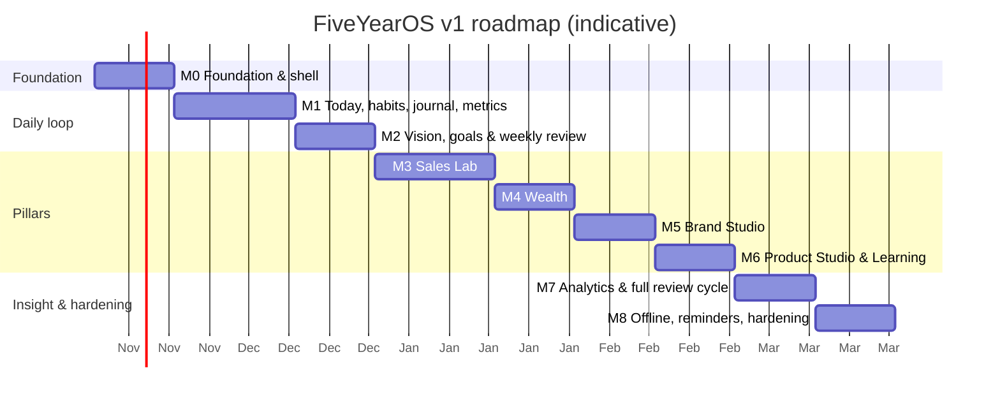

# 7. Development Milestones

**Sequencing principle: start collecting data as early as possible.** Data compounds. A habit or call log started in week 3 is worth more than a perfect dashboard in week 20. So the daily loop ships first, the metrics engine is built before any pillar module, and each pillar module then plugs into it.

Estimates assume one developer working ~15–20 focused hours per week. A milestone ends only when its exit criteria pass. Every milestone ends deployed to production and used for real.

---

### M0 — Foundation and app shell (2 weeks)

| Scope | Exit criteria |
|---|---|
| Next.js + TypeScript strict, Tailwind, shadcn/ui, ESLint boundaries, Prettier | `npm run build` and CI green |
| Supabase projects (local, staging, production on Pro), CLI migrations, type generation | `supabase db reset` reproduces the schema from scratch |
| Conventions migration: `set_updated_at`, RLS policy helper, RLS-coverage CI check | CI fails when a table lacks RLS (verified with a deliberate failing test) |
| Auth: login, TOTP MFA, sign-up disabled + allow-list hook, `proxy.ts` guard | Second email cannot register; `/today` without `aal2` redirects |
| Core tables: `profiles`, `journeys`, `pillars`, `ventures`; `seed_user_defaults()` | Seeded pillars appear after first login |
| App shell: sidebar, bottom nav, module tabs, theme, command palette skeleton | Navigable on phone and desktop |
| PWA: manifest, icons, service worker (Serwist or manual, decided here), install prompt | Lighthouse "installable" passes; installs on Android and iOS |
| Security headers + CSP; weekly encrypted backup workflow | securityheaders.com grade A; first backup artifact present |
| ADR-001…005 written (stack, metrics engine, RLS pattern, offline approach, PWA tooling) | In `docs/adr/` |

### M1 — The daily loop (3 weeks) → *start daily use*

| Scope | Exit criteria |
|---|---|
| Metrics engine: `metric_definitions`, `metric_entries`, `metric_targets`, `metric_facts` (manual branch + `life.focus_minutes`), `metric_series` RPC with flow/stock semantics | pgTAP tests prove flow sums and stock carry-forward at all grains, including custom week start |
| Onboarding wizard J1 (journey, pillars, ventures, metric picks + targets, habits) | Fresh account onboarded in < 20 min |
| Tasks (incl. inbox, top-3), habits + logs + streaks, focus sessions, journal | Unit tests for `streaks.ts`, `periods.ts` |
| Today page (TD-01) with counters, habits, top 3, scheduled tasks | Today LCP ≤ 2.5 s on mid-range phone |
| Quick capture (online): task, metric value, journal note, win | Metric logged in ≤ 3 taps |
| Morning plan (J2) and evening shutdown (J5) | Used for 7 consecutive days by the owner |

### M2 — Vision, goals and weekly rhythm (2 weeks)

| Scope | Exit criteria |
|---|---|
| Versioned vision; goal hierarchy five_year → month; key results linked to metrics; milestones | Goal tree renders; KR progress matches hand calculation |
| `progress.ts` (progress, expected pace, health) mirrored in `v_kr_progress` | Shared fixtures pass in Vitest and pgTAP |
| Review templates (seeded), weekly plan, **weekly review wizard (J6)** with auto-summary | First real weekly review completed |
| `compute_score_snapshots` v1 + `score_snapshots`; `pg_cron` Monday fallback | Snapshot written on review completion and by cron for a skipped week |
| Dashboard v1: journey progress, pillar scores, current goals | Dashboard reachable in 1 tap |

### M3 — Sales Lab (3 weeks)

| Scope | Exit criteria |
|---|---|
| Organisations, contacts, interactions (call outcome pad J3), follow-up queue | Anonymous dial logged in ≤ 3 taps / ≤ 10 s |
| Pipeline stages, deals, kanban (dnd-kit), stage-history trigger, won/lost flow (J4) | Stage changes recorded; lost requires a reason |
| Derived metrics: dials, connects, conversations, meetings, proposals, deals won, revenue won | Counters on Today reflect interactions instantly |
| Playbook items + linking to interactions + `v_playbook_stats`; practice sessions | Win rate per script visible |
| Sales overview: funnel (`v_sales_funnel_weekly`), velocity, by venture | Funnel matches raw counts in a seeded test |

### M4 — Wealth (2 weeks)

| Scope | Exit criteria |
|---|---|
| Accounts, liability terms, monthly balance grid (J7 step 1), `v_net_worth_monthly` | Net worth curve from baseline onward |
| Income streams, categories, transactions (manual), CSV import with dedupe + rules + undo | Re-importing the same CSV creates 0 duplicates |
| Budgets, cash flow, savings rate; FI plan + `fi.ts` projections; debt payoff | FI number and projection verified against a spreadsheet |
| Derived wealth metrics (net worth, debt, income, savings rate, FI %) with `derived_since` | Manual pre-module history preserved |

### M5 — Brand Studio (2 weeks)

| Scope | Exit criteria |
|---|---|
| Platforms, topics, content items, board, markdown editor, calendar | Idea → published flow (J11) end-to-end |
| Publications (cross-posting), performance snapshots, followers per platform (scoped stock) | Per-platform audience chart |
| `v_content_performance` by topic/format/platform; derived brand metrics | "Best topic this quarter" answerable |
| Teaching log (talks/workshops with audience size) | People taught metric populated |

### M6 — Product Studio and Learning (2 weeks)

| Scope | Exit criteria |
|---|---|
| Ideas (scoring), discovery interviews via interactions, experiments, promote-to-product | J10 end-to-end |
| Products, releases, subscriptions; `v_mrr_monthly`; derived MRR/customers | MRR matches manual calculation incl. churn |
| Skills + assessments (radar), resources, notes with full-text search | Search returns notes by body text |
| Journey events auto-suggestions (first deal, launch, debt cleared) | Timeline populated from real events |

### M7 — Analytics and the full review cycle (2 weeks)

| Scope | Exit criteria |
|---|---|
| Pillar analytics pages, grain/range controls, compare periods, correlation view | All charts have accessible table alternative |
| Monthly, quarterly (goal grading, KR freeze) and annual review wizards; vision recalibration | Quarterly review copies unfinished goals forward |
| Year-in-review generator | Generated for a synthetic year of seed data |
| Global search, tags, export (JSON + CSV), import/restore into empty account | Export → restore round-trip yields identical row counts |
| **10-year synthetic dataset load test** | All analytics RPCs ≤ 300 ms p95 (NFR-03, NFR-05) |

### M8 — Offline, reminders and hardening (2 weeks) → *v1.0*

| Scope | Exit criteria |
|---|---|
| Offline outbox (IndexedDB), sync worker, idempotent upserts, sync status UI | Airplane-mode test: 20 captures replay with 0 loss / 0 duplicates |
| Web Push reminders (morning, evening, weekly review, follow-ups) via Edge Function + `pg_cron` | Reminders arrive on installed iOS + Android PWA |
| PWA shortcuts, update toast, logout cache wipe | Verified on devices |
| Accessibility pass (axe + keyboard + screen-reader smoke test) | 0 serious/critical violations |
| Security checklist ([06 §10](06-security.md#10-security-checklist-per-release)), first restore drill | Drill logged; checklist complete |
| Playwright coverage of J1–J7 on mobile + desktop viewports | Green in CI |

---

## After v1: operating the system for five years

| Cadence | Engineering activity |
|---|---|
| Weekly | Automated backup; Dependabot PRs |
| Monthly | Review Supabase advisors and slow queries; dependency updates |
| Quarterly | Restore drill; review which `custom_fields` deserve promotion to columns |
| Yearly (after annual review) | Schema and metric-catalogue review; retire unused metrics (archive); score formula review (new `formula_version` if changed); framework major upgrades; key rotation |

**Candidate v1.x/v2 features**, all additive to this architecture: platform and bank API importers, AI weekly-review summaries and call-note coaching, calendar sync, Health/Family pillars, a public "build in public" page fed by selected metrics, multi-user SaaS.
