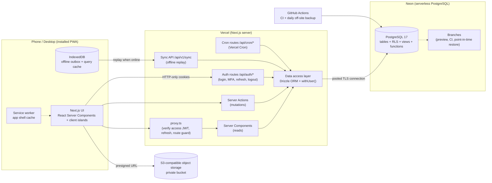

# FiveYearOS — Architecture Blueprint

| | |
|---|---|
| **Document status** | Draft v1.0 — for review before any code is written |
| **Date** | 2026-11-03 |
| **Revision** | v1.1: data platform changed from Supabase to **Neon PostgreSQL + self-issued JWT authentication** ([ADR-001](adr/ADR-001-jwt-auth-and-neon.md)) |
| **Scope** | Complete product and system architecture for a single-owner app expected to hold 5+ years of data |

## 1. What we are building

FiveYearOS is a mobile-first, installable web app that answers three questions every day:

1. **Where am I going?** A versioned five-year vision, broken into yearly, quarterly and monthly goals across four pillars.
2. **What do I do today?** Today's intention, top three priorities, habits, leading-indicator counters (dials, posts, build hours) and follow-ups.
3. **Is it working?** Metrics, pipeline, content performance and net worth rolled up into pillar scores and reviewed weekly, monthly, quarterly and yearly.

| Pillar | Key | What the app tracks |
|---|---|---|
| Sales Mastery | `sales` | Prospects, calls and other interactions, outcomes, objections, pipeline, deals won, practice sessions, skill ratings |
| Product Entrepreneurship | `product` | Problems/ideas, discovery interviews, experiments, products, releases, customers, MRR |
| Personal Branding | `brand` | Content pipeline, publications per platform, performance snapshots, audience growth, teaching (workshops/talks) |
| Financial Independence | `wealth` | Accounts, monthly balance snapshots, net worth, income streams, transactions, budgets, debt payoff, FI plan |

Cross-cutting systems hold the pillars together: **Vision & Goals**, a **generic Metrics engine**, **Habits**, **Tasks & Focus**, **Planning & Reviews**, **Journal**, **Learning** and **Analytics**.

## 2. Eleven decisions that keep it working for five years without a redesign

These are the load-bearing choices. Each is explained in detail in the linked document.

| # | Decision | Why it matters for five years | Detail |
|---|---|---|---|
| D1 | **Generic metrics engine.** KPIs are rows in `metric_definitions`, not columns. Values come from manual `metric_entries` or are *derived* from domain tables, and they can be scoped (per product, platform or account). | New KPIs appear constantly (a new platform, a new product, a new sales motion). Adding one is an insert, not a migration. | [04 §5](04-database-architecture.md#5-the-metrics-engine) |
| D2 | **Flow vs stock metrics.** Every metric is either a *flow*, summed over a period (dials, revenue), or a *stock*, a point-in-time value carried forward (net worth, MRR, followers). | Charts at any grain (day → year) aggregate correctly from day one. | [04 §5.2](04-database-architecture.md#52-flow-vs-stock) |
| D3 | **Effective-dated targets and snapshots.** Targets have `effective_from/to`. Scores, balances and content stats are stored as snapshots, along with the formula version. | Raising your call target in year 3 does not rewrite year 1. History stays honest. | [04 §5.3](04-database-architecture.md#53-targets-scores-and-immutability) |
| D4 | **User-editable lookup tables instead of enums** for pillars, pipeline stages, platforms, topics, categories and ventures. | You can add a fifth pillar, a new platform or new deal stages from Settings. | [04 §2](04-database-architecture.md#2-conventions-applied-to-every-table) |
| D5 | **Journeys and ventures as first-class entities.** A *journey* is a 5-year horizon. A *venture* is where the work happens (employer job, own company, freelance, content brand). | When you move from employee seller to founder, or start a second five-year plan, nothing breaks. | [04 §4.1](04-database-architecture.md#41-core--identity) |
| D6 | **Versioned templates with JSONB answers** for reviews and plans, plus versioned visions. | Review questions will evolve. Old reviews stay readable with the questions that were actually asked. | [04 §4.4](04-database-architecture.md#44-rituals-planning-reviews-journal) |
| D7 | **Correct time and money primitives.** Each record stores the local calendar date (`occurred_on`) plus a UTC timestamp. Money is integer minor units plus an ISO currency, with FX rates. | No timezone drift in daily streaks, no float rounding in five years of finance. | [04 §2](04-database-architecture.md#2-conventions-applied-to-every-table) |
| D8 | **Every row is owned by a user and protected by Postgres RLS.** Each request's queries run in a transaction that sets `app.user_id` from the verified JWT. Same-owner composite foreign keys back this up. | Secure by default today, and it can become a multi-user SaaS later without reworking the data model. | [06 §4](06-security.md#4-authorisation-row-level-security) |
| D9 | **Archive, never hard-delete. Expand/contract migrations. Full export.** | Five years of data survive refactors, mistakes and vendor changes. | [04 §9](04-database-architecture.md#9-migrations-and-schema-evolution) |
| D10 | **Thin routes, feature modules, pure domain library.** Period maths, scoring, FI projections and money live in a pure, unit-tested `lib/domain`. | The logic that decides "am I on track?" is tested and independent of UI churn. | [05 §3](05-component-architecture.md#3-code-organisation) |
| D11 | **Self-issued JWT auth, and the database is never exposed to the browser.** A short-lived signed access JWT and a rotating refresh token live in HTTP-only cookies. Only the Next.js server connects to Neon, through Drizzle, with least-privilege roles. | Small attack surface for a single-owner app, no auth-vendor lock-in, and one token model for pages, Server Actions and the offline sync API. | [06 §3](06-security.md#3-authentication-self-issued-jwt) |

## 3. System at a glance

## 4. Expected data volume (five years, heavy use)

| Area | Rows after 5 years |
|---|---|
| Interactions (calls, emails, meetings) | 50k–100k |
| Metric entries (manual) | ~55k |
| Tasks | ~20k |
| Habit logs | ~15k |
| Transactions | ~10k |
| Content items, publications, snapshots | ~10k |
| Everything else | < 20k |
| **Total** | **< 250k rows, well under 1 GB including indexes** |

That is small for PostgreSQL. The architecture does not need partitioning, sharding or a separate analytics store. It needs good indexes on `(user_id, occurred_on)`, correct aggregation semantics and immutable snapshots. A rollup table is specified as an optional optimisation with a clear trigger point ([04 §7](04-database-architecture.md#7-indexing-volume-and-performance)).

## 5. Open decisions for the owner

These don't block the architecture, but they need answers before or during Milestone 0–1.

| # | Question | Default assumed in this blueprint |
|---|---|---|
| Q1 | Journey start date (day 1 of 1,826)? | 2027-01-01. Configurable at onboarding. |
| Q2 | Base currency and timezone? | Chosen at onboarding. Multi-currency supported, reported in the base currency. |
| Q3 | Are you selling for an employer, your own business, or both? | Both, modelled as separate **ventures**. |
| Q4 | Which content platforms first? | LinkedIn, YouTube, Instagram, X, Newsletter. User-editable. |
| Q5 | Bank data: manual entry, CSV import or bank API? | Monthly balance snapshots + CSV import. No bank API in v1. |
| Q6 | Neon plan? | Free while building. The compute scales to zero when idle, so the first request after a quiet period has a short cold start. **Move to a paid plan before entering real data** for a longer point-in-time-restore window. Daily off-site dumps run on any plan. |
| Q7 | Notifications: web push, email or both? | Web push (installed PWA) with an email fallback for the weekly review. |
| Q8 | AI features (review summaries, call coaching)? | Out of scope for v1. The schema keeps raw text and notes so this can be added later. |
| Q9 | Recovery if the MFA device is lost? | 10 single-use recovery codes, plus an owner-only CLI command run with database credentials. No email-based reset in v1. |
| Q10 | Object storage for attachments? | Cloudflare R2 (S3-compatible, private, presigned URLs). Attachments are a *could* feature, so this can wait until after v1. |
